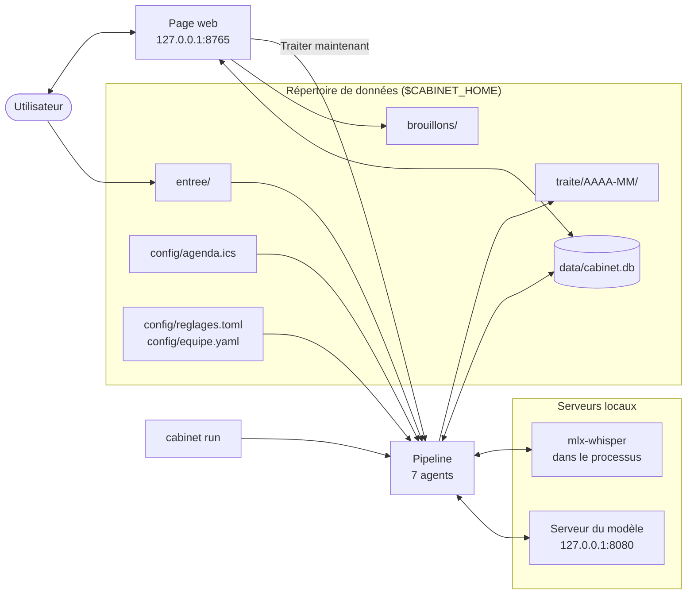

# Architecture

Composants de Cabinet, arborescence du dépôt, modèle d'exécution, choix techniques fixés et table des erreurs. Le but et les principes sont dans `specs/00`. Les tables et les modèles d'échange sont dans `specs/02`.

## 1. Vue d'ensemble



L'application suit le schéma ports et adaptateurs. Les agents ne connaissent que des interfaces (les ports). Le dossier d'entrée, le format ICS, le serveur du modèle et la bibliothèque de transcription sont des adaptateurs remplaçables. C'est ce qui permettra de brancher Microsoft Graph plus tard sans toucher aux agents.

| Composant | Rôle | Détail |
| --- | --- | --- |
| Pipeline | Exécute les agents dans l'ordre, sous un verrou, et journalise chacun | `specs/05 §3` |
| Agents | Sept traitements à nom fixe, qui lisent et écrivent la base | `specs/05`, `specs/06`, `specs/07` |
| Ports | Protocoles `Inbox`, `CalendarSource`, `Transcriber`, `LLM` | section 3.4 |
| Services | Fonctions déterministes sans accès au modèle : séries, rapprochement, extraits, découpage, rendus, jours ouvrés, règles, relances, brouillons | `specs/05` à `specs/08` |
| Lecteurs | Transforment un fichier en `TranscriptData` ou en `CaptureData` | `specs/06 §1`, `specs/07 §2` |
| Page web | Relecture, correction, validation. Aucune logique métier hors des services | `specs/08` |
| Ligne de commande | `cabinet version`, `init`, `run`, `llm-test` | `specs/03 §5` |

## 2. Arborescence du dépôt

```text
pyproject.toml               métadonnées, dépendances, réglages de ruff et de pytest (section 5)
Makefile                     cibles install, check, run (specs/03 §6)
.gitignore
src/cabinet/
  __init__.py                __version__, lue dans les métadonnées du paquet
  clock.py                   heure et jour courants, LOCAL_TZ (section 3.6)
  config.py                  chemins et réglages (specs/03 §1 à §3)
  cli.py                     commandes version, init, run, llm-test (specs/03 §5)
  db/
    base.py                  Base, TZDateTime, get_engine, get_session, init_db (specs/05 §2.1)
    models.py                les quatorze tables (specs/02 §2)
  ports/
    llm.py                   protocole LLM (specs/04 §1)
    inbox.py                 InboxFile, protocole Inbox (specs/05 §5)
    calendar.py              EventData, CalendarError, protocole CalendarSource (specs/05 §6)
    transcriber.py           Segment, TranscriptData, protocole Transcriber (specs/06 §1)
  adapters/
    folder_inbox.py          FolderInbox (specs/05 §5)
    ics_calendar.py          IcsCalendarSource (specs/05 §6)
    mlx_whisper_transcriber.py   MlxWhisperTranscriber, TranscriberUnavailable (specs/06 §3)
  llm/
    types.py                 Message, LLMResult, ConfigError, LLMError (specs/02 §3.1)
    client.py                assert_loopback, LocalLLM (specs/04 §2 et §3)
    prompts/
      minutes.py             schémas et messages du compte rendu (specs/06 §4)
      preparation.py         schémas et messages de l'ordre du jour (specs/06 §9)
      app_vision.py          schéma et messages de la lecture d'image (specs/07 §3)
  readers/
    teams_vtt.py             read_vtt (specs/06 §1.1)
    teams_docx.py            read_docx (specs/06 §1.2)
    notes.py                 read_notes (specs/06 §1.3)
    app_capture.py           parse_app_capture, CaptureFormatError (specs/07 §2)
  services/
    series.py                series_key (specs/05 §6.3)
    matching.py              suggest_meetings (specs/08 §3.1)
    drafts.py                cycle de vie d'un brouillon, mailto_link (specs/08 §7)
    quotes.py                normalize, verify_quote (specs/06 §5)
    chunking.py              estimate_tokens, split_text, merge_minutes (specs/06 §6)
    minutes_render.py        render_minutes (specs/06 §7)
    prep_render.py           build_prep_context, render_prep (specs/06 §9)
    workdays.py              working_days (specs/07 §1)
    roster.py                load_roster, expected_days (specs/03 §4, specs/07 §1)
    rules.py                 run_rules (specs/07 §5)
    reminders.py             build_reminder, sync_reminders (specs/07 §6)
  agents/
    base.py                  protocole Agent, AgentOutcome (section 3.3)
    journal.py               record_run (specs/05 §2.2)
    pipeline.py              Pipeline, PipelineBusy, build_pipeline (specs/05 §3)
    ingestion.py             IngestionAgent (specs/05 §5)
    agenda.py                AgendaAgent (specs/05 §6)
    transcripts.py           TranscriptsAgent (specs/06 §2)
    transcription.py         TranscriptionAgent, purge_audio (specs/06 §3)
    minutes.py               MinutesAgent, regenerate, validate_minutes (specs/06 §4 et §8)
    preparation.py           PreparationAgent (specs/06 §9)
    timesheets.py            TimesheetsAgent (specs/07 §4)
  web/
    app.py                   create_app (specs/08 §1)
    routes/                  dashboard, inbox, meetings, actions, timesheets, drafts, journal (specs/08)
    templates/               base.html et un gabarit par page
    static/                  app.css, app.js
tests/
  contrats/                  écrits par le relecteur, interdits à l'exécutant (specs/09 §2)
    fixtures/                jeux de données du relecteur
  unit/                      écrits par l'exécutant
  fixtures/                  jeux de données de l'exécutant, synthétiques
exemples/                    reglages.exemple.toml, equipe.exemple.yaml
specs/                       cette suite
tickets/                     un ordre de travail par tâche du plan, et ETAT.md
docs/, scripts/, chaine/, revues/   chaîne de développement (docs/CHAINE.md)
```

Un fichier absent de cet arbre ne se crée pas sans l'accord de l'architecte. Un dossier de `src/cabinet/` devient un paquet (fichier `__init__.py` vide) à la tâche qui y crée son premier module.

## 3. Modèle d'exécution

### 3.1 Passage du pipeline

L'unité de traitement est le passage : une exécution des agents dans l'ordre du tableau de `specs/00 §1`. Un passage ne prend aucun paramètre. Chaque agent trouve seul son travail en lisant la base (éléments à l'état `pret`, réunions sans compte rendu, captures relues non contrôlées). Relancer un passage ne retraite donc rien.

L'échec d'un agent n'arrête pas les suivants. À l'intérieur d'un agent, l'échec d'un élément n'arrête pas les autres : l'élément passe à l'état `erreur` avec son message et l'agent compte une erreur dans `AgentOutcome.errors`.

### 3.2 Points d'entrée

| Point d'entrée | Ce qu'il lance | Détail |
| --- | --- | --- |
| `make run` | `uvicorn cabinet.web.app:create_app --factory --host 127.0.0.1 --port 8765` | `specs/03 §6` |
| `cabinet run` | un passage du pipeline, une ligne affichée par agent | `specs/03 §5` |
| `POST /traiter` | un passage du pipeline, puis une redirection vers `/` avec un résumé | `specs/08 §2.3` |

Il n'y a ni planificateur ni surveillance du dossier. Un passage part toujours d'un geste de l'utilisateur.

### 3.3 Contrat commun d'un agent

```python
# src/cabinet/agents/base.py
class Agent(Protocol):
    name: str
    def run(self, session: Session) -> AgentOutcome: ...
```

- `name` est l'un des sept noms du tableau de `specs/00 §1`. Il sert de valeur à `agent_run.agent` et de libellé dans la sortie de `cabinet run`.
- Un agent reçoit ses ports et ses réglages par son constructeur. Il ne lit ni variable d'environnement ni `reglages.toml`. Il obtient les chemins par `paths()` au moment de s'en servir, et l'agent `timesheets` lit le référentiel par `load_roster()` au début de son exécution.
- Un agent valide son travail élément par élément (`session.commit()` après chaque élément réussi, `session.rollback()` après un élément en échec). Le pipeline valide ce qui reste à la sortie de `run`.
- Un agent ne lève une exception que s'il ne peut rien faire du tout (fichier d'agenda absent, référentiel d'équipe invalide). L'orchestrateur la journalise et passe à l'agent suivant.
- Un agent qui appelle le modèle renvoie dans son `AgentOutcome` le nom du modèle et la somme des tokens de ses appels. L'orchestrateur les recopie sur la ligne de journal (`specs/05 §2.3`).

### 3.4 Ports, adaptateurs et doublures

```python
class Inbox(Protocol):                                   # ports/inbox.py
    def scan(self) -> list[InboxFile]: ...

class CalendarSource(Protocol):                          # ports/calendar.py
    def list_events(self, start: date, end: date) -> list[EventData]: ...

class Transcriber(Protocol):                             # ports/transcriber.py
    def transcribe(self, audio_path: Path, language: str = "fr") -> TranscriptData: ...

class LLM(Protocol):                                     # ports/llm.py
    model: str                                           # nom envoyé au serveur, repris au journal
    def complete(
        self,
        messages: list[Message],
        schema: type[BaseModel] | None = None,
        images: list[Path] | None = None,
    ) -> LLMResult: ...
```

| Port | Adaptateur de la version 1 | Doublure des tests | Remplaçant prévu |
| --- | --- | --- | --- |
| `Inbox` | `FolderInbox`, lit `entree/` | un dossier temporaire | boîte de réception par Microsoft Graph |
| `CalendarSource` | `IcsCalendarSource`, lit le fichier désigné par `agenda.ics_path` | un fichier ICS synthétique, ou une liste de `EventData` | agenda par Microsoft Graph |
| `Transcriber` | `MlxWhisperTranscriber`, importe `mlx_whisper` au moment de transcrire | `FakeTranscriber`, qui renvoie un `TranscriptData` fixé et note ses appels | aucun |
| `LLM` | `LocalLLM`, client HTTP d'un serveur compatible OpenAI | `FakeLLM`, qui rejoue une liste de réponses et compte ses appels | aucun |

Les doublures vivent dans les tests (`specs/09 §3`). Aucune doublure n'est dans `src/`, et aucun réglage ne choisit un adaptateur : la version 1 n'en a qu'un par port, assemblé par `build_pipeline` (`specs/05 §3.3`).

### 3.5 Concurrence, verrou et sessions

- Un seul passage à la fois. Le verrou est le fichier `data/pipeline.lock` (`specs/05 §3.2`).
- Chaque agent s'exécute avec sa propre session, ouverte par l'orchestrateur et fermée après lui.
- Une route web est une fonction synchrone (`def`). Elle ouvre sa session par `with get_session() as session`, la valide avant de répondre, et ne la partage avec personne. FastAPI exécute ces routes dans un groupe de fils, de sorte que la page reste consultable pendant un passage lancé par `POST /traiter`.
- SQLite est ouvert en mode journal par défaut. Deux écritures simultanées (une route et un agent) se suivent grâce au délai d'attente de la connexion, fixé à 30 secondes (`connect_args={"timeout": 30}`).
- Il n'y a aucun état global en dehors de la configuration et du cache de moteurs de `db/base.py`. Les dépendances (session, ports, réglages) passent en argument.

### 3.6 Horloge

```python
# src/cabinet/clock.py
LOCAL_TZ = ZoneInfo("Europe/Zurich")

def now() -> datetime:      # heure courante, avec le fuseau LOCAL_TZ
    return datetime.now(LOCAL_TZ)

def today() -> date:        # jour courant dans LOCAL_TZ
    return now().date()
```

`clock.py` est le seul module qui appelle `datetime.now`. Tout autre module écrit `clock.now()` ou `clock.today()`, en important le module et non la fonction (`from cabinet import clock`). Un test fixe la date en remplaçant `cabinet.clock.now`, et `today()` suit.

Le fuseau est une constante en version 1. Aucun réglage ne le change.

## 4. Flux de données entre composants

| Composant | Lit | Écrit |
| --- | --- | --- |
| `ingestion` | `entree/` | `inbox_item` |
| `agenda` | `config/agenda.ics` | `event`, `series`, `meeting` |
| `transcripts` | fichiers des éléments `pret`, `inbox_item` | `transcript`, `inbox_item`, déplacement vers `traite/AAAA-MM/` |
| `transcription` | fichiers audio des éléments `pret` | `transcript`, `inbox_item`, déplacement vers `traite/AAAA-MM/` |
| `minutes` | `transcript`, `meeting`, serveur du modèle | `minutes`, `decision`, `action_item` |
| `preparation` | `meeting`, `series`, `minutes`, `decision`, `action_item`, `transcript`, serveur du modèle | `prep_note` |
| `timesheets` | fichiers des captures, `config/equipe.yaml`, serveur du modèle (image) | `timesheet_capture`, `timesheet_line`, `anomaly`, `draft`, `inbox_item` |
| Page web | toutes les tables | états, corrections, `draft`, `brouillons/*.md`, ligne `deadline` de `reglages.toml` |
| `validate_minutes` | `minutes`, `decision`, `action_item`, `event` | `minutes`, `draft`, `brouillons/*.md`, suppression de l'audio dans `traite/` |

Seul `config.py` connaît les chemins du répertoire de données. Aucun autre module ne construit un chemin vers `entree/`, `traite/`, `brouillons/`, `config/` ou `data/` : il le demande à `paths()` (`specs/03 §1`).

## 5. Choix techniques fixés

| Sujet | Choix | Raison |
| --- | --- | --- |
| Langage | Python 3.12 ou plus, annotations de type partout | `specs/00 §4.6` |
| Paquet | Nom `cabinet`, version `0.1.0` dans `pyproject.toml`, disposition `src/` | La version affichée vient des métadonnées (`importlib.metadata.version("cabinet")`) |
| Environnement | `.venv` créé par `python3 -m venv`, installation par `pip install -e ".[dev]"` | Aucun outil à installer en plus de Python |
| Web | FastAPI, Jinja2, formulaires HTML avec redirection 303 après envoi, sans framework JavaScript | Connu de Thomas, peu de pièges pour un modèle local |
| Ressources | Aucune ressource externe : ni CDN, ni police distante, ni lien `http://` ou `https://` dans `templates/` et `static/` | Principe 2, et un test le vérifie |
| Base | SQLite, SQLAlchemy 2 déclaratif, pas de migration | Un seul utilisateur, un seul fichier |
| Validation | pydantic 2 pour les réglages, le référentiel et toute sortie du modèle | Une erreur de forme est détectée à la frontière |
| Client du modèle | `httpx`, API `chat/completions`, température 0,2, JSON demandé par le prompt | `specs/00 §4.3` |
| Ligne de commande | typer, avec une fonction de rappel vide | `specs/00 §4.9` |
| Agenda | Fichier ICS, récurrences développées par `recurring-ical-events` | Aucune dépendance au service informatique pour démarrer |
| Fuseau | `Europe/Zurich`, constante de `clock.py` | `specs/00 §4.10` |
| Extraits | Contrôle déterministe de chaque citation par `difflib` | Seul moyen simple de repérer une décision inventée |
| Relances | Gabarit, sans modèle | Un texte de relance ne doit pas varier |
| Qualité | `make check` : `ruff check .` puis `pytest -q` | Une seule commande fait foi |
| ruff | `select = ["E4", "E7", "E9", "F", "I", "UP", "B", "SIM"]`, `line-length = 100`, `target-version = "py312"` | `specs/00 §4.8` |
| Longueur | Une fonction de plus de 40 lignes est découpée | Lisible par un modèle local comme par un humain |
| Langue du code | Identifiants en anglais. Textes d'interface, messages d'erreur et docstrings en français | Cohérence avec les réglages et les états |

Section `[tool.ruff]` et `[tool.pytest.ini_options]` de `pyproject.toml` :

```toml
[tool.ruff]
line-length = 100
target-version = "py312"

[tool.ruff.lint]
select = ["E4", "E7", "E9", "F", "I", "UP", "B", "SIM"]

[tool.pytest.ini_options]
testpaths = ["tests"]
```

## 6. Table des erreurs

Chaque classe est définie dans le module de son composant. Aucune n'hérite d'une classe commune : toutes dérivent de `Exception`, sauf mention.

| Classe | Composant | Code | Message type |
| --- | --- | --- | --- |
| `ConfigError` | `assert_loopback` (`llm/client.py`) | sortie 1 en ligne de commande, page d'erreur 500 | « L'adresse du modèle doit être locale (127.0.0.1, localhost ou ::1). Reçu : {hôte}. » |
| `ConfigError` | `load_settings` (`config.py`) | idem | « Clé inconnue dans reglages.toml : {clé}. » ou « Valeur invalide pour {clé} : {détail}. » |
| `ConfigError` | `load_roster` (`services/roster.py`) | agent `timesheets` en erreur au journal | « Référentiel d'équipe introuvable : {chemin}. » ou « Référentiel d'équipe invalide : {détail}. » |
| `LLMError` | `LocalLLM.complete` | élément ou agent en erreur | « Le modèle local a répondu par une erreur HTTP {code}. », « Le modèle local n'a pas répondu en {délai} secondes. », « Le serveur du modèle est injoignable à {adresse}. », « La réponse du modèle n'est pas un JSON conforme après 3 essais : {détail}. » |
| `CalendarError` | `IcsCalendarSource` (`ports/calendar.py`) | agent `agenda` en erreur au journal | « Fichier d'agenda introuvable : {chemin}. Exporte ton agenda au format ICS et place-le à cet endroit. » ou « Fichier d'agenda illisible : {détail}. » |
| `TranscriberUnavailable` | `MlxWhisperTranscriber` | élément audio à l'état `erreur` | « La transcription locale n'est pas installée. Lance : .venv/bin/pip install -e ".[audio]" » |
| `ValueError` | lecteurs `read_vtt`, `read_docx`, `read_notes` | élément à l'état `erreur` | « Le fichier n'est pas au format WebVTT. », « Fichier Word illisible. », « Le fichier de notes est vide. » |
| `ValueError` | `working_days` | 400 à l'écran de vérification | « Période invalide : {valeur}. Format attendu : AAAA-MM. » |
| `CaptureFormatError` | `parse_app_capture` | élément à l'état `erreur` | « Aucune ligne d'imputation lisible dans {fichier}. » |
| `PipelineBusy` | `Pipeline.run` | sortie 2 pour `cabinet run`, redirection avec message pour `POST /traiter` | « Un traitement est déjà en cours. » |
| `TransitionError` | `services/drafts.py` | HTTP 409 | « Un brouillon à l'état {état} ne peut pas passer à {cible}. » ou « Un brouillon à l'état {état} n'est plus modifiable. » |
| `ValidationBlocked` | `validate_minutes`, `MinutesAgent.regenerate` | HTTP 409 | « {n} élément(s) restent à vérifier. Confirme-les ou supprime-les avant de valider. », « Ce compte rendu est déjà validé. », « Un compte rendu validé ne se régénère pas. » |

Codes HTTP employés par les routes, hors de ces classes :

| Code | Cas |
| --- | --- |
| 303 | redirection après un `POST` réussi |
| 400 | formulaire incomplet : consentement non coché pour un audio, période absente au moment de marquer une capture « relue », date illisible |
| 404 | identifiant inconnu |
| 409 | action refusée par l'état de l'objet : élément d'entrée déjà `traite`, compte rendu déjà `valide`, transition de brouillon interdite |

Une erreur de lecture d'un fichier n'est jamais levée jusqu'à l'utilisateur : elle devient l'état `erreur` de l'élément, avec le message dans `inbox_item.error`, et la page Entrée l'affiche.

## 7. Ce qu'un implémenteur doit garder en tête

- Les noms d'agents, de tables, d'états, de routes et de réglages sont contractuels. Ils apparaissent dans les tests de contrat, les adresses et les fichiers de l'utilisateur.
- Seul `config.py` construit un chemin vers le répertoire de données. Un test cherche `~/Cabinet` dans `src/` et ne l'admet que là.
- Seul `clock.py` lit l'heure du système. Importer le module (`from cabinet import clock`), jamais la fonction, sinon les tests ne peuvent pas fixer la date.
- Un agent trouve son travail dans la base. Il ne reçoit jamais une liste d'éléments en paramètre et ne retraite jamais un élément `traite`.
- Aucune fonction d'envoi, sous aucune forme. Le lien `mailto:` est construit par `mailto_link`, et c'est la messagerie de l'utilisateur qui envoie.
- `mlx_whisper` s'importe à l'intérieur de `transcribe`. Importer `cabinet.web.app` ne doit jamais le charger.
- Une dépendance absente de `specs/00 §4.11` ne s'ajoute pas. La bibliothèque standard couvre le reste (`tomllib`, `difflib`, `zoneinfo`, `hashlib`, `urllib.parse`).
- Un message d'erreur est en français, complet, et dit quoi faire quand c'est possible. Il ne contient jamais le texte d'une source.
