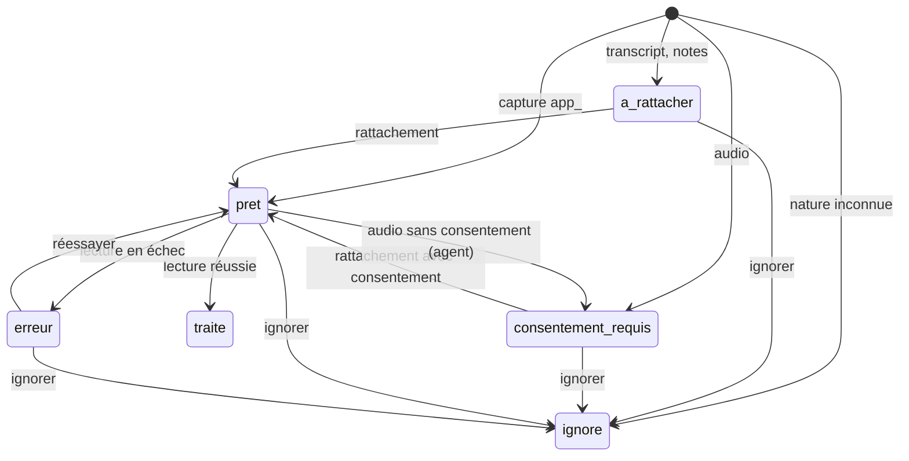
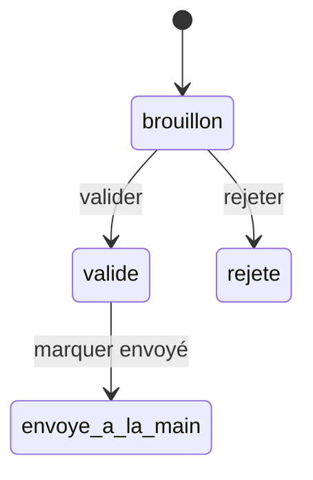
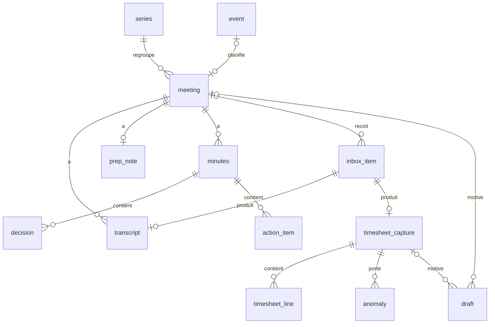

# Modèle de données

Tables de la base SQLite et modèles d'échange entre composants. Ce document fait foi sur les noms de tables, de colonnes, d'états et de champs. Les autres documents les utilisent sans les redéfinir. Les réglages et le référentiel d'équipe sont dans `specs/03-configuration.md`.

## 1. Conventions

1. La base est le fichier `data/cabinet.db` du répertoire de données (`specs/03 §1`). SQLAlchemy 2 en style déclaratif (`DeclarativeBase`, `Mapped`, `mapped_column`), dans `src/cabinet/db/models.py`. `Base` est définie dans `src/cabinet/db/base.py`.
2. Les tables sont créées par `init_db()` au démarrage (`Base.metadata.create_all`). Il n'y a aucune migration en version 1 : un changement de schéma après la première utilisation réelle demande une décision de l'architecte.
3. Les noms de tables sont ceux du tableau de la section 2, au singulier et en `snake_case`. Chaque table a une clé `id` entière, auto-incrémentée.
4. Les clés étrangères sont activées à chaque connexion par un écouteur `connect` qui exécute `PRAGMA foreign_keys=ON`.
5. Un état est une énumération de chaînes (`enum.StrEnum`), stockée sous sa valeur (`Enum(..., native_enum=False, values_callable=...)`). Les valeurs sont en français et sans accent, parce qu'elles apparaissent dans les adresses et les filtres.
6. Une date et heure est toujours « consciente » de son fuseau. Le type de colonne est `TZDateTime` (section 1.1). Une date seule est une colonne `Date`.
7. Une liste ou un objet libre est une colonne `JSON`. Le contenu d'une colonne JSON est décrit par un modèle de la section 3.
8. Un texte court est `String`, un texte long (`text`, `content_md`, `body`, `quote`, `detail`, `error`, `summary`) est `Text`.
9. Sauf mention contraire, une colonne est obligatoire (`nullable=False`).

### 1.1 Type `TZDateTime`

SQLite ne garde pas le fuseau d'une date. `db/base.py` définit donc un `TypeDecorator` sur `DateTime`, selon la recette de la documentation de SQLAlchemy (source en `specs/00 §7`).

```python
class TZDateTime(TypeDecorator):
    impl = DateTime
    cache_ok = True

    def process_bind_param(self, value, dialect):   # écriture
        ...  # None passe. Une date sans fuseau lève ValueError. Sinon conversion en UTC, fuseau retiré.

    def process_result_value(self, value, dialect):  # lecture
        ...  # None passe. Sinon la valeur reçoit le fuseau UTC puis est convertie dans LOCAL_TZ.
```

`LOCAL_TZ` vaut `ZoneInfo("Europe/Zurich")` et vit dans `src/cabinet/clock.py` (`specs/01 §3.6`). Une valeur relue porte donc toujours le fuseau `Europe/Zurich`, et l'ordre de tri en base est celui du temps réel, y compris autour d'un changement d'heure.

## 2. Tables

Quatorze tables. L'ordre du tableau est l'ordre de création conseillé dans `models.py`.

| Table | Rôle | Écrite par |
| --- | --- | --- |
| `agent_run` | Journal des exécutions d'agent | `record_run` (`specs/05 §2`) |
| `inbox_item` | Un fichier déposé dans `entree/` | ingestion, page Entrée, agents de lecture |
| `event` | Une occurrence d'évènement de l'agenda | agenda |
| `series` | Une série de réunions de même titre | agenda, page Entrée |
| `meeting` | Une réunion, avec ou sans évènement | agenda, page Entrée |
| `transcript` | Le texte d'une source rattachée à une réunion | transcripts, transcription |
| `prep_note` | La fiche de préparation d'une réunion | preparation |
| `minutes` | Une version du compte rendu d'une réunion | minutes |
| `decision` | Une décision d'un compte rendu | minutes, page Réunion |
| `action_item` | Une action d'un compte rendu | minutes, pages Réunion et Actions |
| `timesheet_capture` | Une capture d'imputations | timesheets, écran de vérification |
| `timesheet_line` | Une ligne d'une capture | timesheets, écran de vérification |
| `anomaly` | Une anomalie relevée sur une capture relue | timesheets |
| `draft` | Un brouillon de message | validation d'un compte rendu, relances, page Brouillons |

### 2.1 `agent_run`

| Colonne | Type | Nul | Défaut | Note |
| --- | --- | --- | --- | --- |
| `id` | Integer | non | | |
| `agent` | String(50) | non | | nom de l'agent (`specs/05 §1`) |
| `target_ref` | String(200) | non | `""` | cible libre, par exemple `reunion:7` |
| `status` | `RunStatus` | non | `en_cours` | `en_cours`, `ok`, `erreur` |
| `started_at` | TZDateTime | non | | |
| `ended_at` | TZDateTime | oui | | renseignée en sortie, à l'état `ok` comme à l'état `erreur` |
| `model` | String(100) | oui | | noté par l'agent qui appelle le modèle |
| `prompt_tokens` | Integer | oui | | |
| `completion_tokens` | Integer | oui | | |
| `error` | Text | oui | | message de l'exception, sans trace d'appel |

Le journal ne contient jamais le texte d'un prompt ni celui d'une réponse du modèle.

### 2.2 `inbox_item`

| Colonne | Type | Nul | Défaut | Note |
| --- | --- | --- | --- | --- |
| `id` | Integer | non | | |
| `path` | String(500) | non | | chemin relatif au répertoire de données, en notation POSIX (`entree/x.vtt`, puis `traite/2026-11/x.vtt`) |
| `sha256` | String(64) | non | | unique |
| `kind` | `InboxKind` | non | | `teams_transcript`, `notes`, `audio`, `app_capture_text`, `app_capture_image`, `inconnu` |
| `status` | `InboxStatus` | non | `nouveau` | section 2.2.1 |
| `name_date` | Date | oui | | date lue dans le nom du fichier |
| `meeting_id` | FK `meeting.id` | oui | | `ON DELETE SET NULL` |
| `consent_confirmed` | Boolean | non | faux | audio seulement |
| `consent_at` | TZDateTime | oui | | |
| `error` | Text | oui | | message de la dernière erreur de lecture. Pour une capture lue, les lignes ignorées à la lecture (`specs/07 §4.1`) |
| `detected_at` | TZDateTime | non | | |

#### 2.2.1 États d'un élément d'entrée

| État | Posé par | Sens |
| --- | --- | --- |
| `nouveau` | personne en version 1 | valeur par défaut de la colonne, jamais visible : l'ingestion fixe l'état de départ dans la même transaction |
| `a_rattacher` | ingestion | transcript ou notes, en attente d'une réunion |
| `consentement_requis` | ingestion, agent de transcription | audio sans consentement confirmé |
| `pret` | ingestion (captures), page Entrée (rattachement) | sera lu au prochain passage du pipeline |
| `traite` | agent de lecture | lu, fichier rangé dans `traite/AAAA-MM/` |
| `erreur` | agent de lecture | lecture impossible, message dans `error` |
| `ignore` | ingestion (nature `inconnu`), page Entrée | écarté par l'utilisateur ou par sa nature |



Un élément `erreur` se rejoue par le bouton « Réessayer » de la page Entrée, qui le remet à `pret` et vide `error` (`specs/08 §3.4`). Le kit ne prévoyait aucune sortie de l'état `erreur` autre que `ignore`. Un élément `traite` ne change plus d'état. Les routes de la page Entrée répondent 409 sur un élément `traite` (`specs/08 §3`).

### 2.3 `event`

| Colonne | Type | Nul | Défaut | Note |
| --- | --- | --- | --- | --- |
| `id` | Integer | non | | |
| `uid` | String(300) | non | | `UID` de l'évènement ICS |
| `title` | String(300) | non | | |
| `start` | TZDateTime | non | | début de l'occurrence |
| `end` | TZDateTime | non | | |
| `all_day` | Boolean | non | faux | |
| `location` | String(300) | oui | | |
| `organizer` | String(200) | oui | | adresse de l'organisateur, sans le préfixe `mailto:` |
| `attendees` | JSON | non | `[]` | liste d'adresses, sans le préfixe `mailto:` |
| `cancelled` | Boolean | non | faux | |

Contrainte d'unicité sur (`uid`, `start`) : une série récurrente donne une ligne par occurrence.

### 2.4 `series`

| Colonne | Type | Nul | Défaut | Note |
| --- | --- | --- | --- | --- |
| `id` | Integer | non | | |
| `key` | String(300) | non | | unique, calculée par `series_key` (`specs/05 §6.3`) |
| `label` | String(300) | non | | titre du premier évènement rencontré |
| `followed` | Boolean | non | faux | basculée par l'utilisateur |
| `client` | String(200) | oui | | aucun composant de la version 1 ne le renseigne ni ne le lit |

### 2.5 `meeting`

| Colonne | Type | Nul | Défaut | Note |
| --- | --- | --- | --- | --- |
| `id` | Integer | non | | |
| `event_id` | FK `event.id` | oui | | unique, `ON DELETE SET NULL`. Nul pour une réunion hors agenda |
| `series_id` | FK `series.id` | non | | |
| `title` | String(300) | non | | |
| `date` | Date | non | | jour de la réunion dans `LOCAL_TZ` |

L'heure d'une réunion est celle de son évènement (`meeting.event.start`). Une réunion hors agenda n'a pas d'heure.

La suppression d'une réunion supprime en cascade ses `transcript`, `prep_note`, `minutes`, `decision` et `action_item` (`ON DELETE CASCADE` et `cascade="all, delete-orphan"` sur les relations). Ses `inbox_item` et ses `draft` restent, avec `meeting_id` remis à nul.

### 2.6 `transcript`

| Colonne | Type | Nul | Défaut | Note |
| --- | --- | --- | --- | --- |
| `id` | Integer | non | | |
| `meeting_id` | FK `meeting.id` | non | | cascade |
| `inbox_item_id` | FK `inbox_item.id` | non | | |
| `source` | `TranscriptSource` | non | | `teams`, `audio`, `notes` |
| `text` | Text | non | | texte complet, une ligne par segment |
| `segments` | JSON | non | `[]` | liste de `Segment` (section 3.3) |

### 2.7 `prep_note`

| Colonne | Type | Nul | Défaut | Note |
| --- | --- | --- | --- | --- |
| `id` | Integer | non | | |
| `meeting_id` | FK `meeting.id` | non | | cascade, unique : une fiche par réunion |
| `content_md` | Text | non | | |
| `status` | `DocStatus` | non | `brouillon` | `brouillon`, `valide` |
| `created_at` | TZDateTime | non | | date de la dernière génération |

Aucun parcours de la version 1 ne passe une fiche à l'état `valide`. L'état existe pour la version suivante.

### 2.8 `minutes`

| Colonne | Type | Nul | Défaut | Note |
| --- | --- | --- | --- | --- |
| `id` | Integer | non | | |
| `meeting_id` | FK `meeting.id` | non | | cascade |
| `version` | Integer | non | | 1 pour le premier compte rendu, puis 2, 3 |
| `content_md` | Text | non | `""` | rendu Markdown (`specs/06 §7`) |
| `summary` | Text | non | | 120 mots au plus |
| `open_points` | JSON | non | `[]` | liste de chaînes |
| `next_meeting` | String(300) | oui | | texte libre, tel que dit dans la source |
| `status` | `DocStatus` | non | `brouillon` | `brouillon`, `valide` |
| `created_at` | TZDateTime | non | | |

Contrainte d'unicité sur (`meeting_id`, `version`). Le compte rendu courant d'une réunion est celui de plus grande version.

### 2.9 `decision`

| Colonne | Type | Nul | Défaut | Note |
| --- | --- | --- | --- | --- |
| `id` | Integer | non | | |
| `meeting_id` | FK `meeting.id` | non | | cascade |
| `minutes_id` | FK `minutes.id` | non | | cascade |
| `text` | Text | non | | |
| `quote` | Text | non | | extrait de la source, 200 caractères au plus |
| `verified` | Boolean | non | faux | vrai si l'extrait est retrouvé, ou si l'utilisateur confirme |

### 2.10 `action_item`

| Colonne | Type | Nul | Défaut | Note |
| --- | --- | --- | --- | --- |
| `id` | Integer | non | | |
| `meeting_id` | FK `meeting.id` | non | | cascade |
| `minutes_id` | FK `minutes.id` | non | | cascade |
| `description` | Text | non | | |
| `owner` | String(200) | oui | | seulement si un nom est dit dans la source |
| `due_date` | Date | oui | | seulement si une date est dite dans la source |
| `quote` | Text | non | | |
| `verified` | Boolean | non | faux | |
| `status` | `ActionStatus` | non | `ouvert` | `ouvert`, `fait` |

### 2.11 `timesheet_capture`

| Colonne | Type | Nul | Défaut | Note |
| --- | --- | --- | --- | --- |
| `id` | Integer | non | | |
| `inbox_item_id` | FK `inbox_item.id` | non | | |
| `period` | String(7) | oui | | `AAAA-MM`. Nul tant que la période n'est ni lue ni saisie |
| `source` | `CaptureSource` | non | | `texte`, `vision` |
| `verified` | Boolean | non | faux | « relue » par l'utilisateur |
| `verified_at` | TZDateTime | oui | | |
| `checked_at` | TZDateTime | oui | | date du dernier passage des règles |

La suppression d'une capture supprime en cascade ses lignes et ses anomalies.

### 2.12 `timesheet_line`

| Colonne | Type | Nul | Défaut | Note |
| --- | --- | --- | --- | --- |
| `id` | Integer | non | | |
| `capture_id` | FK `timesheet_capture.id` | non | | cascade |
| `person` | String(200) | non | | nom tel que lu, puis tel que corrigé à l'écran de vérification |
| `project_code` | String(100) | non | | |
| `days` | Float | non | | jours, décimales admises |

### 2.13 `anomaly`

| Colonne | Type | Nul | Défaut | Note |
| --- | --- | --- | --- | --- |
| `id` | Integer | non | | |
| `capture_id` | FK `timesheet_capture.id` | non | | cascade |
| `person` | String(200) | non | | nom du référentiel |
| `rule_id` | String(10) | non | | `R1` à `R4` |
| `detail` | Text | non | | phrase affichée et reprise dans la relance |
| `severity` | `Severity` | non | | `bloquant`, `a_verifier` |

### 2.14 `draft`

| Colonne | Type | Nul | Défaut | Note |
| --- | --- | --- | --- | --- |
| `id` | Integer | non | | |
| `kind` | `DraftKind` | non | | `envoi_cr`, `relance_cra` |
| `recipients` | JSON | non | `[]` | liste d'adresses |
| `subject` | String(300) | non | | |
| `body` | Text | non | | |
| `status` | `DraftStatus` | non | `brouillon` | `brouillon`, `valide`, `rejete`, `envoye_a_la_main` |
| `meeting_id` | FK `meeting.id` | oui | | `ON DELETE SET NULL` |
| `capture_id` | FK `timesheet_capture.id` | oui | | `ON DELETE SET NULL` |
| `created_at` | TZDateTime | non | | |

Un brouillon de relance appartient à la personne dont l'adresse est le premier élément de `recipients`. C'est par cette adresse que `sync_reminders` reconnaît un brouillon existant (`specs/07 §6`).



Aucune autre transition n'existe. `envoye_a_la_main` constate un geste de l'utilisateur dans sa messagerie. L'application n'envoie rien.

## 3. Modèles d'échange

Modèles pydantic 2 qui circulent entre adaptateurs, services et agents. Chacun est défini dans le module indiqué et nulle part ailleurs.

### 3.1 Modèle de langage (`src/cabinet/llm/types.py`)

```python
class Message(BaseModel):
    role: Literal["system", "user", "assistant"]
    content: str

class LLMResult(BaseModel):
    text: str                              # réponse, sans bloc de raisonnement
    parsed: BaseModel | None = None        # instance du schéma demandé, sinon None
    prompt_tokens: int | None = None
    completion_tokens: int | None = None

class ConfigError(Exception): ...
class LLMError(Exception): ...
```

`ConfigError` et `LLMError` vivent dans ce module. `config.py` et `services/roster.py` importent `ConfigError` d'ici.

### 3.2 Entrée et agenda

```python
# src/cabinet/ports/inbox.py
class InboxFile(BaseModel):
    path: Path               # chemin absolu du fichier dans entree/
    sha256: str
    kind: str                # valeur de InboxKind
    name_date: date | None
    size: int                # octets

# src/cabinet/ports/calendar.py
class EventData(BaseModel):
    uid: str
    title: str
    start: datetime          # avec fuseau, converti en LOCAL_TZ
    end: datetime
    all_day: bool
    location: str | None
    organizer: str | None
    attendees: list[str]
    cancelled: bool
```

### 3.3 Sources de réunion (`src/cabinet/ports/transcriber.py`)

```python
class Segment(BaseModel):
    start_s: float | None    # secondes depuis le début de l'enregistrement
    end_s: float | None
    speaker: str | None
    text: str

class TranscriptData(BaseModel):
    text: str                # segments dans l'ordre, une ligne par segment
    segments: list[Segment]
```

### 3.4 Agents (`src/cabinet/agents/base.py`)

```python
class AgentOutcome(BaseModel):
    processed: int = 0            # éléments traités avec succès pendant ce passage
    errors: int = 0               # éléments en échec, sans arrêt de l'agent
    model: str | None = None      # nom du modèle appelé, si l'agent en a appelé un
    prompt_tokens: int = 0        # somme sur tous les appels du passage
    completion_tokens: int = 0
```

Les trois derniers champs servent au journal : l'orchestrateur les recopie sur la ligne `agent_run` de l'exécution (`specs/05 §2.3`). Un agent qui n'appelle pas le modèle les laisse à leur valeur par défaut.

### 3.5 Compte rendu et fiche

```python
# src/cabinet/llm/prompts/minutes.py
class DecisionOut(BaseModel):
    text: str
    quote: str               # extrait mot pour mot de la source, 200 caractères au plus

class ActionOut(BaseModel):
    description: str
    owner: str | None        # seulement si un nom est dit dans la source
    due_date: date | None    # seulement si une date est dite dans la source
    quote: str

class MinutesOut(BaseModel):
    summary: str             # 120 mots au plus
    decisions: list[DecisionOut]
    actions: list[ActionOut]
    open_points: list[str]
    next_meeting: str | None

class SummaryOut(BaseModel):
    summary: str             # résumé final d'une source longue, 120 mots au plus

# src/cabinet/services/quotes.py
class QuoteCheck(BaseModel):
    found: bool
    score: float             # entre 0.0 et 1.0

# src/cabinet/llm/prompts/preparation.py
class AgendaPoint(BaseModel):
    title: str
    reason: str              # renvoie à une action, une décision ou une note

class AgendaOut(BaseModel):
    points: list[AgendaPoint] = Field(min_length=3, max_length=6)

# src/cabinet/services/prep_render.py
class PrepAction(BaseModel):
    description: str
    owner: str | None
    due_date: date | None
    meeting_date: date       # réunion d'où vient l'action

class PrepDecision(BaseModel):
    text: str
    meeting_date: date

class PrepContext(BaseModel):
    title: str
    meeting_date: date
    start: datetime | None   # None pour une réunion hors agenda
    location: str | None
    attendees: list[str]
    last_summary: str | None           # résumé du dernier compte rendu validé de la série
    last_summary_date: date | None
    open_actions: list[PrepAction]     # actions ouvertes de la série
    recent_decisions: list[PrepDecision]   # décisions des trois dernières réunions validées
    notes: list[str]                   # texte des notes rattachées à la réunion à venir

    @property
    def has_history(self) -> bool:     # un compte rendu validé dans la série, ou au moins une note
        return self.last_summary is not None or bool(self.notes)
```

Les limites de longueur de `MinutesOut` (120 mots, 200 caractères) sont demandées au modèle par le prompt. Le schéma ne les impose pas : une réponse trop longue est tronquée par l'agent (`specs/06 §4`), elle ne provoque pas de nouvel appel.

### 3.6 Imputations

```python
# src/cabinet/readers/app_capture.py
class TimesheetLineData(BaseModel):
    person: str
    project_code: str
    days: float

class CaptureData(BaseModel):
    period: str | None       # AAAA-MM si la capture le dit
    lines: list[TimesheetLineData]
    warnings: list[str]      # une phrase par ligne illisible

# src/cabinet/llm/prompts/app_vision.py
class CaptureOut(BaseModel):
    period: str | None
    lines: list[TimesheetLineData]

# src/cabinet/services/rules.py
class AnomalyData(BaseModel):
    person: str
    rule_id: str             # R1 à R4
    detail: str
    severity: str            # valeur de Severity
```

`Absence`, `Person` et `Roster` décrivent le fichier `equipe.yaml`. Ils sont dans `specs/03 §4`.

## 4. Relations et suppressions



| Suppression de | Effet |
| --- | --- |
| `meeting` | supprime `transcript`, `prep_note`, `minutes`, `decision`, `action_item`. Met à nul `inbox_item.meeting_id` et `draft.meeting_id` |
| `minutes` | supprime ses `decision` et `action_item` |
| `timesheet_capture` | supprime `timesheet_line` et `anomaly`. Met à nul `draft.capture_id` |
| `event` | met à nul `meeting.event_id` |
| `series` | refusée tant qu'une réunion s'y rattache |

Aucune page de la version 1 ne supprime une réunion, une série, un évènement ni une capture. Ces règles protègent la base contre une suppression faite à la main ou par un test.

## 5. Ce qu'un implémenteur doit garder en tête

- Les noms de tables, de colonnes et d'états sont contractuels. Les tests de contrat relisent certaines tables en SQL par ces noms.
- Une date et heure sans fuseau est une erreur. `TZDateTime` la refuse à l'écriture. Ne jamais appeler `datetime.now()` ni `date.today()` hors de `clock.py`.
- `inbox_item.path` est relatif au répertoire de données. Le chemin absolu se reconstruit avec `paths().home`.
- Le compte rendu courant est celui de plus grande `version`. Une régénération ajoute une version, elle ne remplace jamais une ligne `minutes`.
- `verified` a deux origines : le contrôle déterministe de l'extrait, ou la confirmation de l'utilisateur. Rien d'autre ne le passe à vrai.
- Les colonnes JSON contiennent des listes simples (`attendees`, `open_points`, `recipients`) ou des objets conformes à `Segment`. Écrire une liste Python, jamais une chaîne JSON déjà sérialisée.
- `series.client` et l'état `valide` d'une `prep_note` existent sans usage en version 1. Ne pas leur inventer un rôle.
