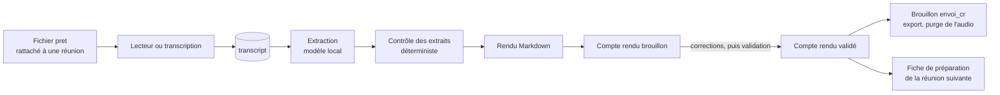

# Réunions

De la source déposée au compte rendu validé, puis à la fiche de préparation de la réunion suivante. Les tables sont dans `specs/02 §2`, les modèles d'échange dans `specs/02 §3`, le client du modèle et les règles des prompts dans `specs/04`. Les pages et les routes sont dans `specs/08 §4` et `§5`.



## 1. Lecteurs

Un lecteur transforme un fichier en `TranscriptData`. Il ne touche ni à la base ni au fichier. Tout fichier illisible lève `ValueError` avec un message en français : le lecteur enveloppe les exceptions de la bibliothèque qu'il utilise.

```python
def read_vtt(path: Path) -> TranscriptData: ...      # readers/teams_vtt.py
def read_docx(path: Path) -> TranscriptData: ...     # readers/teams_docx.py
def read_notes(path: Path) -> TranscriptData: ...    # readers/notes.py
```

Dans les trois cas, `TranscriptData.text` reprend les segments dans l'ordre, une ligne par segment, sous la forme `{orateur} : {texte}` quand l'orateur est connu et `{texte}` sinon.

### 1.1 `read_vtt`

1. Lire le fichier en `utf-8-sig`. Si la première ligne ne commence pas par `WEBVTT`, lever `ValueError` : « Le fichier n'est pas au format WebVTT. »
2. Découper en blocs séparés par une ligne vide. Ignorer le bloc d'en-tête et les blocs qui commencent par `NOTE`, `STYLE` ou `REGION`.
3. Dans chaque bloc, chercher la ligne d'horodatage (`(\d{2}:)?\d{2}:\d{2}\.\d{3}\s+-->\s+(\d{2}:)?\d{2}:\d{2}\.\d{3}`). Une ligne d'identifiant peut la précéder. Un bloc sans cette ligne est ignoré.
4. Convertir les deux horodatages en secondes (`start_s`, `end_s`).
5. Le texte est fait des lignes qui suivent, jointes par une espace. Si une balise `<v Nom>` s'y trouve (`<v(?:\.[^ >]*)?\s+([^>]+)>`), `speaker` vaut le nom. Sinon `speaker` vaut `None`.
6. Retirer toutes les balises (`<[^>]+>`), décoder les entités HTML (`html.unescape`), retirer les espaces autour. Un segment au texte vide est écarté.
7. Aucun segment : lever `ValueError` : « Aucune réplique lisible dans le fichier WebVTT. »

Les répliques successives d'un même orateur ne sont pas fusionnées : un bloc donne un segment.

### 1.2 `read_docx`

La forme d'un transcript Teams en `.docx` est une hypothèse, à vérifier sur un exemple anonymisé pendant la phase A du lot 2 (`specs/00 §4.13`) : une ligne « orateur puis horodatage », suivie du texte.

1. Ouvrir le fichier avec `docx.Document(path)`. Une erreur d'ouverture lève `ValueError` : « Fichier Word illisible. »
2. Garder les paragraphes dont le texte n'est pas vide, dans l'ordre.
3. Un paragraphe est une ligne d'en-tête s'il correspond à `^(?P<speaker>.+?)\s+(?P<time>\d{1,2}:\d{2}(?::\d{2})?)$`. Il ouvre un segment : `speaker` vaut le nom, `start_s` l'horodatage en secondes (`m:ss` ou `h:mm:ss`), `end_s` vaut `None`.
4. Les paragraphes qui suivent, jusqu'à la prochaine ligne d'en-tête, forment le texte du segment, joints par une espace.
5. Si aucune ligne d'en-tête n'est reconnue, renvoyer un seul segment sans orateur ni horodatage, dont le texte est l'ensemble des paragraphes joints par un retour à la ligne.
6. Aucun paragraphe : lever `ValueError` : « Le document Word ne contient aucun texte. »

### 1.3 `read_notes`

1. Lire les octets. Les décoder en `utf-8-sig`, et en `cp1252` si le décodage échoue.
2. Si la première ligne est `---`, retirer tout jusqu'à la ligne `---` suivante, comprise. Sans seconde ligne `---`, ne rien retirer.
3. Retirer les espaces de début et de fin. Un texte vide lève `ValueError` : « Le fichier de notes est vide. »
4. Renvoyer un seul segment sans orateur ni horodatage.

Tests : `tests/unit/test_teams_readers.py` et `tests/unit/test_notes_reader.py`, avec des fichiers synthétiques dans `tests/fixtures/transcripts/`. Cas attendus : WebVTT avec orateurs et horodatages, WebVTT sans balise d'orateur, `.docx` au format supposé avec un segment par prise de parole, `.docx` de texte libre en un segment, notes en UTF-8 avec accents, notes en cp1252, en-tête entre `---` retiré, fichier vide.

## 2. Agent `transcripts`

```python
class TranscriptsAgent:
    name = "transcripts"
    def run(self, session: Session) -> AgentOutcome: ...
```

1. Sélectionner les `inbox_item` à l'état `pret`, de nature `teams_transcript` ou `notes`, qui ont un `meeting_id`, par `id` croissant.
2. Pour chaque élément, reconstruire le chemin absolu (`paths().home / item.path`). Fichier absent du disque : traiter comme une erreur de lecture, avec « Fichier introuvable : {nom}. »
3. Choisir le lecteur : `read_vtt` pour `.vtt`, `read_docx` pour `.docx`, `read_notes` pour la nature `notes`.
4. En cas de succès : créer un `transcript` (`source` vaut `teams` ou `notes`, `segments` reçoit la liste des segments en dictionnaires), ranger le fichier par `archive_file` (`specs/05 §4`), valider, compter un élément traité.
5. Sur toute exception : annuler, passer l'élément à `erreur`, écrire le message dans `item.error` (500 caractères au plus), valider, compter une erreur, passer à l'élément suivant.

## 3. Transcription audio

```python
# src/cabinet/adapters/mlx_whisper_transcriber.py
class TranscriberUnavailable(Exception): ...

class MlxWhisperTranscriber:
    def __init__(self, model: str): ...
    def transcribe(self, audio_path: Path, language: str = "fr") -> TranscriptData: ...

# src/cabinet/agents/transcription.py
class TranscriptionAgent:
    name = "transcription"
    def __init__(self, transcriber: Transcriber): ...
    def run(self, session: Session) -> AgentOutcome: ...

def purge_audio(session: Session, meeting_id: int) -> int: ...
```

### 3.1 `MlxWhisperTranscriber.transcribe`

1. Importer `mlx_whisper` à l'intérieur de la méthode. Si l'import échoue, lever `TranscriberUnavailable` : « La transcription locale n'est pas installée. Lance : .venv/bin/pip install -e ".[audio]" »
2. Appeler la bibliothèque :

   ```python
   resultat = mlx_whisper.transcribe(str(audio_path), path_or_hf_repo=self.model, language=language)
   ```

3. Construire un `Segment` par élément de `resultat["segments"]` : `start_s` et `end_s` viennent de `start` et `end`, `text` est le texte sans espaces autour, `speaker` vaut `None`. Écarter les segments vides.
4. Renvoyer `TranscriptData`, avec une ligne de texte par segment.

Le module n'importe jamais `mlx_whisper` à son chargement. Importer `cabinet.web.app` ne doit pas le faire apparaître dans `sys.modules`.

La fiche de `mlx-whisper` confirme la fonction `transcribe` et le paramètre `path_or_hf_repo`. Le paramètre `language` n'y figure pas en toutes lettres : il est à confirmer à la recette du lot 2.

La bibliothèque télécharge le modèle depuis Hugging Face à sa première utilisation, puis le garde dans son cache. Ce téléchargement est la seule connexion sortante liée à l'application. Il ne transmet aucune donnée de réunion. Pour l'éviter le jour d'une réunion, Thomas lance une première transcription d'essai sur un audio synthétique pendant la recette du lot 2.

### 3.2 `TranscriptionAgent.run`

1. Sélectionner les `inbox_item` à l'état `pret`, de nature `audio`, qui ont un `meeting_id`, par `id` croissant.
2. Pour chaque élément, vérifier de nouveau `consent_confirmed`. S'il est faux : ne pas appeler le transcripteur, remettre l'élément à `consentement_requis`, valider, compter une erreur, passer au suivant. C'est le second contrôle du principe 3.
3. Appeler `transcriber.transcribe(chemin, "fr")`.
4. En cas de succès : créer un `transcript` de source `audio`, ranger le fichier par `archive_file`, valider, compter un élément traité.
5. Sur `TranscriberUnavailable` : passer l'élément à `erreur` avec le message de l'exception, valider, compter une erreur, continuer.
6. Sur toute autre exception : même traitement, avec le message « Transcription impossible : {détail}. »

### 3.3 `purge_audio`

1. Sélectionner les `inbox_item` de la réunion, de nature `audio` et à l'état `traite`.
2. Pour chacun, supprimer le fichier `paths().home / item.path` s'il existe.
3. Renvoyer le nombre de fichiers supprimés.

La ligne `inbox_item` reste en base avec son chemin. Les fichiers d'une autre réunion, les fichiers non audio et les audios non traités ne sont jamais touchés. La fonction est appelée par `validate_minutes` (section 8.2).

Tests : `tests/unit/test_transcription.py`, avec `FakeTranscriber`. Cas attendus : audio `pret` au consentement confirmé transcrit en source `audio`, audio `pret` sans consentement non transmis et remis à `consentement_requis`, bibliothèque absente et élément en `erreur` avec l'indication d'installation, `mlx_whisper` absent de `sys.modules` après l'import de `cabinet.web.app`, langue `fr` transmise, purge limitée aux audios de la réunion.

## 4. Extraction du compte rendu

```python
# src/cabinet/llm/prompts/minutes.py
def build_minutes_messages(meeting_title: str, meeting_date: date, source_text: str) -> list[Message]: ...

# src/cabinet/agents/minutes.py
class MinutesAgent:
    name = "minutes"
    def __init__(self, llm: LLM, context_tokens: int = 64000): ...
    def run(self, session: Session) -> AgentOutcome: ...
    def regenerate(self, session: Session, meeting_id: int) -> Minutes: ...
```

### 4.1 Prompt

`build_minutes_messages` renvoie deux messages. Le message système est ce texte, suivi de la phrase de garde (`specs/04 §4`) :

```text
Tu rédiges le compte rendu d'une réunion à partir de sa source.
Règles :
- N'invente rien. Tout ce que tu écris vient de la source.
- Le résumé fait 120 mots au plus.
- Chaque décision et chaque action porte un extrait recopié mot pour mot de la source, de 200 caractères au plus.
- Le responsable d'une action n'est donné que si un nom est dit dans la source. Sinon null.
- L'échéance d'une action n'est donnée que si une date est dite dans la source, au format AAAA-MM-JJ. Sinon null.
- Les points ouverts sont les questions restées sans décision.
- La prochaine séance n'est donnée que si elle est dite dans la source. Sinon null.
- S'il n'y a ni décision ni action, renvoie des listes vides.
```

Le message utilisateur est :

```text
Réunion : {titre}, {JJ.MM.AAAA}.
<source>
{texte de la source}
</source>
```

### 4.2 Source d'une réunion

La source est le texte des transcripts de la réunion, pris par `id` croissant. Avec un seul transcript, c'est son texte. Avec plusieurs, chaque texte est précédé d'un intertitre `## Source {n} : {libellé}`, où le libellé vaut « transcript Teams », « notes » ou « transcription audio » selon `transcript.source`. Les blocs sont séparés par une ligne vide.

Cette fonction (`meeting_source(session, meeting_id) -> str`, dans `agents/minutes.py`) sert à l'extraction, au contrôle des extraits et à la confirmation à l'écran. Les trois voient donc le même texte.

### 4.3 `MinutesAgent.run`

1. Sélectionner les réunions qui ont au moins un `transcript` et aucun `minutes`, par date puis par `id`.
2. Pour chaque réunion, construire la source (section 4.2), puis obtenir un `MinutesOut` : par un seul appel au modèle, ou par morceaux quand la source est longue (section 6).
3. Sur `LLMError` : annuler, ne rien écrire pour cette réunion, compter une erreur, passer à la suivante. La réunion sera reprise au passage suivant.
4. Ramener la réponse aux limites : couper `summary` à 120 mots et chaque `quote` à 200 caractères. Un extrait coupé reste une sous-chaîne de la source.
5. Dans une seule transaction, créer le `minutes` (`version` 1, état `brouillon`, `summary`, `open_points`, `next_meeting`), puis une `decision` et un `action_item` par élément (`status` `ouvert`, `verified` à faux).
6. Contrôler chaque extrait contre la source (section 5) et fixer `verified`.
7. Remplir `content_md` par `render_minutes` (section 7).
8. Valider et compter un élément traité. Additionner les tokens des appels.

Avant la tâche V2-05 l'étape 6 n'existe pas, et avant V2-06 `content_md` reste vide. Chaque tâche ajoute son étape sans changer les précédentes.

### 4.4 `MinutesAgent.regenerate`

La régénération n'est offerte que sur un compte rendu à l'état `brouillon` (`specs/08 §4.3`).

1. Charger le compte rendu courant de la réunion. S'il est `valide`, lever `ValidationBlocked` : « Un compte rendu validé ne se régénère pas. »
2. Refaire l'extraction comme en 4.3, étapes 2 et 4. Une `LLMError` remonte à l'appelant et rien n'est modifié.
3. Supprimer les `decision` et les `action_item` de la réunion qui appartiennent à un compte rendu non validé.
4. Créer un `minutes` de version suivante (plus grande version de la réunion, plus un), avec ses décisions et ses actions, puis contrôler les extraits et faire le rendu.
5. Renvoyer le nouveau compte rendu. Les lignes `minutes` des versions précédentes restent en base, avec leur `content_md`.

Tests : `tests/unit/test_minutes_agent.py`, avec `FakeLLM` et des jeux dans `tests/fixtures/minutes/`. Cas attendus : compte rendu version 1 créé avec les valeurs du jeu de test, balises `<source>` et phrase de garde exacte dans le prompt, `LLMError` sans aucune ligne pour la réunion et réunions suivantes traitées, réunion sans transcript et réunion déjà dotée d'un compte rendu ignorées, version 2 créée par `regenerate` et version 1 conservée, `owner` et `due_date` à `None` quand le modèle renvoie `null`.

## 5. Contrôle des extraits

Le contrôle est déterministe. Il n'appelle jamais le modèle et ne corrige jamais un extrait.

```python
# src/cabinet/services/quotes.py
def normalize(text: str) -> str: ...
def verify_quote(quote: str, source: str, threshold: float = 0.85) -> QuoteCheck: ...
```

`normalize` : mettre en minuscules, retirer les accents (décomposition `NFKD` puis suppression des caractères combinants), remplacer tout caractère de ponctuation par une espace, réduire les suites d'espaces et retirer celles des bords.

Algorithme de `verify_quote` :

1. Normaliser l'extrait et la source.
2. Si l'extrait normalisé fait moins de 10 caractères, renvoyer `QuoteCheck(found=False, score=0.0)`, même s'il existe dans la source.
3. Si l'extrait normalisé est une sous-chaîne de la source normalisée, renvoyer `found=True` et `score=1.0`.
4. Sinon comparer l'extrait à des fenêtres glissantes de la source, de la longueur de l'extrait, par pas d'un quart de cette longueur (au moins 1). Si la source est plus courte que l'extrait, la comparer en entier.
5. La comparaison est `difflib.SequenceMatcher(None, fenêtre, extrait, autojunk=False)`. Un seul objet sert pour toutes les fenêtres : `set_seq2(extrait)` une fois, `set_seq1(fenêtre)` à chaque pas. Ne calculer `ratio()` que si `quick_ratio()` dépasse le meilleur score déjà obtenu.
6. Renvoyer le meilleur score, et `found` à vrai s'il atteint `threshold`.

Le filtre par `quick_ratio()` tient la contrainte de durée : moins de 2 secondes pour un extrait sur une source de 200 000 caractères.

L'agent appelle `verify_quote(quote, source)` avec la source de la section 4.2 et écrit `found` dans `verified`.

Tests : `tests/unit/test_quotes.py`. Cas attendus : extrait exact trouvé avec le score 1.0 malgré la casse, les accents et la ponctuation, extrait avec deux mots changés sur vingt trouvé, extrait inventé non trouvé, extrait de 5 caractères non trouvé, durée sous 2 secondes sur 200 000 caractères, `verified` conforme après l'agent.

## 6. Sources longues

```python
# src/cabinet/services/chunking.py
def estimate_tokens(text: str) -> int: ...
def split_text(text: str, max_words: int = 12000, overlap_words: int = 200) -> list[str]: ...
def merge_minutes(parts: list[MinutesOut]) -> MinutesOut: ...

# src/cabinet/llm/prompts/minutes.py
def build_summary_messages(summaries: list[str]) -> list[Message]: ...
```

`estimate_tokens` renvoie la longueur du texte en caractères divisée par 3,5, arrondie au supérieur.

L'agent découpe la source quand `estimate_tokens(source)` dépasse la moitié de `context_tokens`, soit 32 000 tokens avec le réglage par défaut. En dessous, il fait un seul appel.

Algorithme de `split_text` :

1. Découper le texte en lignes. Un mot est une suite de caractères sans espace.
2. Remplir un morceau ligne après ligne tant que son nombre de mots reste inférieur ou égal à `max_words`.
3. Quand la ligne suivante ferait dépasser, clore le morceau. Le suivant commence par le recouvrement : les dernières lignes entières du morceau clos, tant que leur total reste inférieur ou égal à `overlap_words`.
4. Aucun morceau ne coupe une ligne. Une ligne qui dépasse à elle seule `max_words` forme un morceau à part, seul cas où un morceau dépasse la limite.
5. Renvoyer les morceaux dans l'ordre. Un texte qui tient dans la limite donne un seul morceau.

Traitement par morceaux, dans `MinutesAgent` :

1. Appeler le modèle une fois par morceau, avec `build_minutes_messages` et le schéma `MinutesOut`.
2. Réunir les résultats par `merge_minutes` :
   | Champ | Règle de fusion |
   | --- | --- |
   | `decisions` | garder la première de chaque groupe dont les `text` normalisés se ressemblent à 0,9 ou plus (`SequenceMatcher.ratio()`) |
   | `actions` | même règle, sur `description` |
   | `open_points` | réunion sans doublon exact, dans l'ordre d'apparition |
   | `next_meeting` | dernière valeur non nulle |
   | `summary` | les résumés des morceaux, joints par un retour à la ligne, en attendant l'étape suivante |
3. Faire un dernier appel avec `build_summary_messages(résumés des morceaux)` et le schéma `SummaryOut`. Son résultat remplace `summary`. Le message système demande un résumé unique de 120 mots au plus, sans rien ajouter aux résumés fournis, suivi de la phrase de garde. Les résumés sont placés entre les balises.
4. Le nombre d'appels vaut le nombre de morceaux plus un.
5. Si un appel échoue, tout le compte rendu échoue : la `LLMError` remonte et rien n'est écrit pour la réunion.

Le contrôle des extraits se fait contre la source entière, pas contre un morceau.

Tests : `tests/unit/test_chunking.py`. Cas attendus : source courte et un seul appel, source de 30 000 mots découpée en trois morceaux de 12 000 mots au plus avec recouvrement, aucune ligne coupée, deux actions presque identiques fusionnées, nombre d'appels égal au nombre de morceaux plus un, échec d'un morceau sans aucune ligne en base.

## 7. Rendu Markdown

```python
# src/cabinet/services/minutes_render.py
def render_minutes(meeting, minutes, decisions, actions, open_points, next_meeting) -> str: ...
```

Le rendu est fait par gabarit, jamais par le modèle. Il a toujours six rubriques, dans cet ordre.

```markdown
# Compte rendu : {titre}

Date : {JJ.MM.AAAA}

## Participants

- {adresse}

## Résumé

{résumé}

## Décisions

- {texte} (à vérifier)

## Actions

| Action | Responsable | Échéance |
| --- | --- | --- |
| {description} (à vérifier) | {responsable} | {JJ.MM.AAAA} |

## Points ouverts

- {point}

## Prochaine séance

{prochaine séance}
```

| Rubrique | Contenu | Si vide |
| --- | --- | --- |
| Participants | `attendees` de l'évènement de la réunion, une puce par adresse | « Non renseignés. » |
| Résumé | `minutes.summary` | jamais vide |
| Décisions | une puce par décision | « Aucune décision relevée. » |
| Actions | une ligne de tableau par action. Responsable absent : « non précisé ». Échéance absente : « non précisée » | « Aucune action relevée. », sans tableau |
| Points ouverts | une puce par point | « Aucun point ouvert. » |
| Prochaine séance | `next_meeting` | « Non précisée. » |

La mention « (à vérifier) » suit le texte de chaque décision et de chaque action dont `verified` est faux. Dans une cellule de tableau, une barre verticale est écrite `\|` et un retour à la ligne devient une espace.

`content_md` est recalculé après l'extraction, après chaque correction de l'utilisateur et juste avant la validation.

## 8. Corrections et validation

### 8.1 Corrections sur un brouillon

Tant que le compte rendu est à l'état `brouillon`, la page Réunion permet de modifier ou supprimer chaque décision et chaque action, de confirmer un élément « à vérifier » (ce qui passe `verified` à vrai), de modifier le résumé et de régénérer (`specs/08 §4.3`). Chaque correction recalcule `content_md`.

Modifier le texte d'une décision ou la description d'une action ne change pas `verified`. Modifier son extrait relance le contrôle de la section 5 sur le nouvel extrait, et `verified` prend le résultat : un extrait retouché à la main et introuvable dans la source redevient « à vérifier ». La confirmation explicite de l'utilisateur passe `verified` à vrai dans tous les cas.

Toute tentative de correction sur un compte rendu `valide` est refusée par le code 409.

### 8.2 `validate_minutes`

```python
# src/cabinet/agents/minutes.py
class ValidationBlocked(Exception): ...

def validate_minutes(session: Session, minutes_id: int, delete_audio: bool = True) -> Minutes: ...
```

1. Charger le compte rendu. S'il est déjà `valide`, lever `ValidationBlocked` : « Ce compte rendu est déjà validé. »
2. Compter les décisions et les actions du compte rendu dont `verified` est faux. S'il en reste, lever `ValidationBlocked` : « {n} élément(s) restent à vérifier. Confirme-les ou supprime-les avant de valider. » Rien n'est modifié.
3. Refaire le rendu et l'écrire dans `content_md`.
4. Passer le compte rendu à `valide`.
5. Écrire le fichier `brouillons/AAAA-MM-JJ_cr_{id}.md`, où la date est celle de la réunion et `id` celui du compte rendu. Son contenu est `content_md`.
6. Créer un brouillon par `create_draft` (`specs/08 §7`) : nature `envoi_cr`, destinataires égaux aux `attendees` de l'évènement (liste vide pour une réunion hors agenda), objet « Compte rendu : {titre}, {JJ.MM.AAAA} », corps égal à `content_md`, `meeting_id` renseigné.
7. Si `delete_audio` est vrai, appeler `purge_audio(session, meeting_id)`. La route passe la valeur du réglage `transcription.delete_audio_after_validation`.
8. Renvoyer le compte rendu. L'appelant valide la session.

Un compte rendu validé n'est plus modifiable. Ses actions ouvertes apparaissent à la page Actions (`specs/08 §5`) et alimentent les fiches de préparation de la série.

Tests : `tests/unit/test_meeting_page.py`. Cas attendus : six rubriques et mention « (à vérifier) », validation refusée par 409 avec un élément non vérifié, validation réussie après confirmation ou suppression, fichier d'export et brouillon `envoi_cr` adressé aux participants, audio supprimé ou gardé selon le réglage, correction refusée par 409 sur un compte rendu validé.

## 9. Fiche de préparation

```python
# src/cabinet/services/prep_render.py
def build_prep_context(session: Session, meeting: Meeting) -> PrepContext: ...
def render_prep(context: PrepContext, agenda: AgendaOut | None) -> str: ...

# src/cabinet/llm/prompts/preparation.py
def build_agenda_messages(context: PrepContext) -> list[Message]: ...

# src/cabinet/agents/preparation.py
class PreparationAgent:
    name = "preparation"
    def __init__(self, llm: LLM): ...
    def run(self, session: Session) -> AgentOutcome: ...
    def regenerate(self, session: Session, meeting_id: int) -> PrepNote: ...
```

### 9.1 `build_prep_context`

Le contexte s'assemble sans modèle. « Réunion validée » désigne une réunion dont le compte rendu courant est à l'état `valide`.

| Champ | Règle |
| --- | --- |
| `title`, `meeting_date` | de la réunion |
| `start`, `location`, `attendees` | de son évènement. `None`, `None` et liste vide pour une réunion hors agenda |
| `last_summary`, `last_summary_date` | résumé et date de la réunion validée la plus récente de la même série, de date strictement antérieure |
| `open_actions` | actions à l'état `ouvert` des réunions validées de la même série, triées par échéance, sans échéance en dernier |
| `recent_decisions` | décisions des trois réunions validées les plus récentes de la série, de date strictement antérieure |
| `notes` | texte des transcripts de source `notes` rattachés à la réunion à venir |

Une action ouverte d'une autre série n'apparaît jamais.

### 9.2 `render_prep`

```markdown
# Fiche de préparation : {titre}

Date : {JJ.MM.AAAA} à {HH:MM}
Lieu : {lieu}
Participants : {adresses séparées par une virgule}

## Dernier compte rendu ({JJ.MM.AAAA})

{résumé}

## Actions ouvertes

- {description} ({responsable}, échéance {JJ.MM.AAAA})

## Décisions récentes

- {JJ.MM.AAAA} : {texte}

## Notes déposées

{texte des notes}

## Ordre du jour proposé

1. {titre du point} ({raison})
```

- Les lignes « Lieu » et « Participants » disparaissent quand l'information manque. L'heure disparaît pour une réunion hors agenda.
- Une rubrique sans contenu est omise.
- La rubrique « Ordre du jour proposé » n'apparaît que si `agenda` n'est pas `None`.
- Quand `context.has_history` est faux, la fiche contient l'en-tête puis la seule phrase « Aucun historique pour cette série. »

La première fiche d'une série est donc presque vide, et c'est attendu : la valeur de la fiche grandit avec l'historique.

### 9.3 Ordre du jour

`build_agenda_messages` renvoie deux messages. Le message système est ce texte, suivi de la phrase de garde :

```text
Tu proposes l'ordre du jour d'une réunion à partir de son contexte.
Règles :
- Propose 3 à 6 points.
- Chaque point renvoie à une action ouverte, à une décision ou à une note du contexte, et sa raison le dit.
- N'invente aucun sujet absent du contexte.
```

Le message utilisateur place entre les balises `<source>` le rendu du contexte sans ordre du jour (`render_prep(context, None)`).

### 9.4 `PreparationAgent.run`

1. Sélectionner les réunions dont la série est suivie (`series.followed`), dont la date est comprise entre `clock.today()` et sept jours plus tard, bornes incluses, et qui n'ont pas de `prep_note`.
2. Pour chaque réunion, construire le contexte.
3. Si `has_history` est faux : créer la fiche avec la phrase de la section 9.2. Le modèle n'est pas appelé.
4. Sinon appeler le modèle avec le schéma `AgendaOut`, puis rendre la fiche avec l'ordre du jour.
5. Sur `LLMError` : rendre la fiche sans la rubrique « Ordre du jour proposé », la créer quand même et compter une erreur.
6. Créer le `prep_note` à l'état `brouillon` avec `created_at = clock.now()`, valider, compter un élément traité.

`regenerate` refait les étapes 2 à 5 pour une réunion donnée et remplace `content_md` et `created_at` de sa fiche, ou la crée si elle manque. La route l'appelle à l'intérieur de `record_run` (`specs/05 §2.2`).

Tests : `tests/unit/test_preparation.py`, avec `FakeLLM`. Cas attendus : réunion d'une série suivie dans 3 jours avec historique et fiche complète, absence d'historique avec la phrase du contrat et zéro appel au modèle, série non suivie ou réunion dans 10 jours sans fiche, échec du modèle et fiche sans ordre du jour, actions d'une autre série absentes, bascule « suivie » et régénération qui remplace le contenu.

## 10. Ce qu'un implémenteur doit garder en tête

- Le consentement se contrôle deux fois : à la page Entrée et dans l'agent de transcription. Retirer l'un des deux contrôles viole le principe 3.
- L'extraction, le contrôle des extraits et l'écran de confirmation lisent la même source, construite par `meeting_source`. Ne pas reconstruire ce texte ailleurs.
- `verified` ne change que par `verify_quote` (à l'extraction, ou quand l'utilisateur modifie l'extrait) et par la confirmation de l'utilisateur. Une modification du texte seul ne le change pas.
- Un compte rendu se crée dans une seule transaction. Une `LLMError` ne laisse aucune ligne pour la réunion.
- La régénération ajoute une version. Elle ne modifie jamais une ligne `minutes` existante et ne touche jamais aux éléments d'un compte rendu validé.
- Le Markdown vient toujours de `render_minutes` et de `render_prep`. Le modèle ne rédige que des champs de schéma.
- Les dates s'écrivent `JJ.MM.AAAA` dans les documents produits et `AAAA-MM-JJ` dans les noms de fichiers et les schémas.
- `purge_audio` supprime des fichiers de l'utilisateur. Elle ne vise que les audios traités de la réunion validée, et rien d'autre.
- `mlx_whisper` s'importe dans `transcribe`, pas en tête de module.
