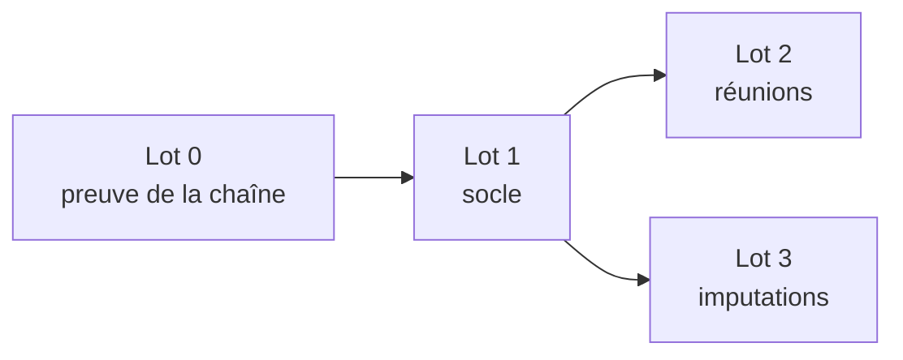
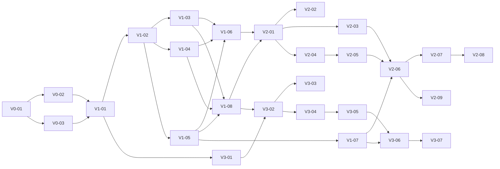

# Plan d'implémentation

Plan en quatre lots, exécutable sans décision d'architecture à prendre. Chaque tâche indique les fichiers à créer ou modifier, les sections de spécification qu'ils implémentent et un critère « Terminé quand » vérifiable par une commande. Les lots 0 à 3 sont les vagues 0 à 3 du kit, et les tâches gardent les identifiants des tickets (`V0-01` à `V3-07`), parce que les tests de contrat, la boucle de développement et `tickets/ETAT.md` les citent déjà.

Chaque tâche a un ordre de travail dans `tickets/<identifiant>.md`, lu par l'exécutant. Si un ticket et cette suite se contredisent, la suite fait foi et l'écart se note dans `tickets/notes/<identifiant>.md`.

Règles permanentes :

- Lire les sections citées avant d'écrire un fichier. Les noms cités sont contractuels.
- Après chaque tâche : `make check`. Tout doit être vert, ruff comme pytest.
- N'implémenter que la tâche en cours. Un fichier absent de sa liste ne se modifie pas, sauf nécessité notée dans `tickets/notes/<identifiant>.md`, avec le changement le plus petit possible.
- Une fonction de plus de 40 lignes se découpe. Identifiants en anglais, messages et docstrings en français.
- Aucune dépendance hors de `specs/00 §4.11`. Aucune fonction d'envoi. Aucune donnée réelle.
- En cas de doute entre deux lectures de la spécification, choisir la plus simple et la plus prudente, et l'écrire dans `tickets/notes/<identifiant>.md`, une ligne datée par décision. Ne s'arrêter pour demander que si un principe de `specs/00 §5` est en jeu.
- Le déroulé d'un lot (phase A du relecteur, boucle de l'exécutant, phase B, verdict) est dans `docs/CHAINE.md`, `docs/REPRISE.md` et `REVIEW.md`. Ce plan ne le reformule pas.

Dans les critères « Terminé quand », `make check` s'entend avec les tests de contrat de la tâche activés, ce que la boucle fait par `CABINET_TICKET=<identifiant>`.

| Lot | But | Tâches | Ce que Thomas fournit avant |
| --- | --- | --- | --- |
| 0 | Prouver que la chaîne de développement fonctionne | V0-01 à V0-03 | Serveur du modèle et passerelle en marche |
| 1 | Poser le socle : réglages, base, entrée, agenda, brouillons, pipeline | V1-01 à V1-08 | Rien pour le développement. Un export ICS de son agenda pour sa recette |
| 2 | Réunions : sources, comptes rendus, actions, fiches | V2-01 à V2-09 | L'option `audio` installée pour sa recette |
| 3 | Imputations : captures, contrôle, relances | V3-01 à V3-07 | Un échantillon anonymisé d'écran d'imputation, les règles R1 à R4 confirmées, le référentiel d'équipe |

## Lot 0 : preuve de la chaîne

Ce lot ne livre aucune fonction à l'utilisateur. Il mesure si l'exécutant termine trois tâches simples sans aide (`specs/09 §6.1`). Les tests de contrat de ses trois tâches existent déjà (`tests/contrats/test_v0_0*.py`, 51 tests).

### V0-01 Squelette du dépôt

Dépend de : aucune.

Fichiers : `pyproject.toml`, `Makefile`, `.gitignore` (`specs/03 §6`, `specs/01 §5`), `src/cabinet/__init__.py`, `src/cabinet/web/app.py` (`specs/08 §1.1` et `§2.4`), `src/cabinet/cli.py` (`specs/03 §5`), `tests/unit/test_sante.py`.

Terminé quand : `make install` sort avec 0 sur un clone neuf, `make check` passe avec `tests/contrats/test_v0_01_squelette.py`, `.venv/bin/cabinet version` affiche `0.1.0`, et `GET /sante` renvoie `{"statut": "ok", "version": "0.1.0"}`.

### V0-02 Client du modèle local et garde de bouclage

Dépend de : V0-01.

Fichiers : `src/cabinet/llm/types.py` (`specs/02 §3.1`), `src/cabinet/llm/client.py` (`specs/04 §2` et `§3`), `src/cabinet/ports/llm.py` (`specs/04 §1`), `src/cabinet/cli.py` (`specs/03 §5.1`), `tests/unit/test_llm_client.py`.

Terminé quand : `make check` passe avec `tests/contrats/test_v0_02_client_llm.py`, dont les cas `http://127.0.0.1:8080/v1` accepté, `https://api.exemple.test/v1` refusé par `ConfigError`, deux réponses invalides puis une valide en trois appels, et trois réponses invalides levant `LLMError`.

### V0-03 Journal des exécutions d'agent

Dépend de : V0-01.

Fichiers : `src/cabinet/clock.py` (`specs/01 §3.6`), `src/cabinet/db/base.py` (`specs/05 §2.1`, `specs/02 §1.1`), `src/cabinet/db/models.py` (table `agent_run`, `specs/02 §2.1`), `src/cabinet/agents/journal.py` (`specs/05 §2.2`), `src/cabinet/web/routes/journal.py`, `src/cabinet/web/templates/base.html`, `src/cabinet/web/templates/journal.html` (`specs/08 §8`), `src/cabinet/web/app.py`, `tests/unit/test_journal.py`.

Terminé quand : `make check` passe avec `tests/contrats/test_v0_03_journal.py`, dont une ligne `erreur` qui survit à l'annulation de la session de l'appelant, deux bases distinctes pour deux valeurs de `CABINET_HOME`, et 100 lignes affichées par `GET /journal` pour 150 en base.

Fin de lot : recette de `specs/09 §6.1`, puis rapport `revues/vague-0.md` avec les mesures et le verdict.

## Lot 1 : socle

Ordre conseillé : V1-01, V1-02, puis V1-03, V1-04 et V1-05, puis V1-06, V1-07, V1-08.

### V1-01 Configuration et répertoire de données

Dépend de : V0-02, V0-03.

Fichiers : `src/cabinet/config.py` (`specs/03 §1` à `§3`), `src/cabinet/cli.py` (`specs/03 §5.2`, et `llm-test` branché sur `load_settings`), `src/cabinet/db/base.py` (passage par `paths()`), `tests/unit/test_config.py`.

Terminé quand : `.venv/bin/pytest tests/unit/test_config.py -q` passe avec les cas : `cabinet init` crée cinq dossiers et `config/reglages.toml`, un second `init` laisse intact un fichier modifié, `load_settings()` sans fichier rend les valeurs par défaut de `specs/03 §3`, une clé inconnue lève `ConfigError` avec son nom, une adresse distante lève `ConfigError`. Et `grep -rn "~/Cabinet" src/` ne cite que `config.py`.

### V1-02 Modèle de données

Dépend de : V1-01.

Fichiers : `src/cabinet/db/models.py` (`specs/02 §2`), `src/cabinet/db/base.py`, `tests/unit/test_models.py`.

Terminé quand : `.venv/bin/pytest tests/unit/test_models.py -q` passe avec les cas : `init_db()` crée les quatorze tables aux noms de `specs/02 §2`, un `transcript` sans réunion est refusé, deux `inbox_item` de même `sha256` et deux `event` de mêmes `uid` et `start` sont refusés, la suppression d'une réunion emporte ses transcripts, fiches, comptes rendus, décisions et actions, chaque modèle fait un aller-retour, et un second `init_db()` ne perd rien.

### V1-03 Dossier d'entrée et agent d'ingestion

Dépend de : V1-02.

Fichiers : `src/cabinet/ports/inbox.py` (`specs/02 §3.2`), `src/cabinet/adapters/folder_inbox.py`, `src/cabinet/agents/ingestion.py` (`specs/05 §5`), `src/cabinet/agents/base.py` (`specs/01 §3.3`, `specs/02 §3.4`), `tests/unit/test_ingestion.py`.

Terminé quand : `.venv/bin/pytest tests/unit/test_ingestion.py -q` passe avec chaque ligne du tableau de `specs/05 §5.1`, extension en majuscules comprise, `2026-11-23_point-hebdo.vtt` daté du 23.11.2026, les trois cas de fichier ignoré, aucun doublon après deux passages, et `processed` égal au nombre de nouveaux éléments.

### V1-04 Agenda par fichier ICS

Dépend de : V1-02.

Fichiers : `src/cabinet/ports/calendar.py` (`specs/02 §3.2`), `src/cabinet/adapters/ics_calendar.py` (`specs/05 §6.1`), `src/cabinet/services/series.py` (`specs/05 §6.3`), `src/cabinet/agents/agenda.py` (`specs/05 §6.2`), `tests/unit/test_agenda.py`, `tests/fixtures/agenda/`.

Terminé quand : `.venv/bin/pytest tests/unit/test_agenda.py -q` passe avec un évènement hebdomadaire développé en une occurrence par semaine, un évènement annulé par statut et un par titre sans réunion créée, `series_key("RE: Point hebdo 12") == series_key("Point hebdo")`, `series_key("Comité été") == series_key("comite ete")`, aucun doublon après deux passages, un fichier absent qui lève `CalendarError`, et des heures relues dans `Europe/Zurich`.

### V1-05 Gabarit web et tableau de bord

Dépend de : V1-02.

Fichiers : `src/cabinet/web/templates/base.html`, `dashboard.html`, `settings.html`, `error.html`, `src/cabinet/web/static/app.css` (`specs/08 §1.4`), `src/cabinet/web/routes/dashboard.py` (`specs/08 §2.1`, `§2.2`, `§2.4`), `src/cabinet/web/app.py` (gardes de `specs/08 §1.3`), `tests/unit/test_dashboard.py`.

Terminé quand : `.venv/bin/pytest tests/unit/test_dashboard.py -q` passe avec `GET /` à 200 sur une base vide, les huit liens de navigation sur `/` et sur `/journal`, les quatre compteurs conformes à la base préparée, « J-3 », « aujourd'hui » et « échéance dépassée » selon la date fixée, seules les réunions des 7 prochains jours dans l'ordre, un `POST` d'origine étrangère refusé par 403, et `grep -rnE "https?://" src/cabinet/web/templates src/cabinet/web/static` qui ne renvoie rien.

### V1-06 Page Entrée, rattachement et consentement

Dépend de : V1-03, V1-04, V1-05.

Fichiers : `src/cabinet/services/matching.py` (`specs/08 §3.1`), `src/cabinet/web/routes/inbox.py`, `src/cabinet/web/templates/inbox.html` (`specs/08 §3.2` à `§3.4`), `tests/unit/test_inbox_page.py`.

Terminé quand : `.venv/bin/pytest tests/unit/test_inbox_page.py -q` passe avec des suggestions du bon jour triées par similarité, un transcript rattaché et passé à `pret`, un audio sans la case refusé par 400 et laissé à `consentement_requis`, le même avec la case passé à `pret` avec `consent_at`, une réunion hors agenda créée avec sa série, un élément `traite` refusé par 409, et un élément `erreur` rejoué par `reessayer`.

### V1-07 Brouillons sans envoi

Dépend de : V1-05.

Fichiers : `src/cabinet/services/drafts.py` (`specs/08 §7.1` à `§7.3`), `src/cabinet/web/routes/drafts.py`, `src/cabinet/web/templates/drafts.html`, `src/cabinet/web/static/app.js` (`specs/08 §7.4`), `tests/unit/test_drafts.py`.

Terminé quand : `.venv/bin/pytest tests/unit/test_drafts.py -q` passe avec les trois transitions permises, `rejete` vers `valide` et `brouillon` vers `envoye_a_la_main` refusées par 409, le fichier d'export créé à la validation, le lien `mailto:` absent avant validation et fidèle après décodage, et `grep -rn "smtplib\|sendMail\|send_message" src/` qui ne renvoie rien.

### V1-08 Orchestrateur du pipeline

Dépend de : V1-03, V1-04, V1-05.

Fichiers : `src/cabinet/agents/pipeline.py` (`specs/05 §3`), `src/cabinet/cli.py` (`specs/03 §5.3`), `src/cabinet/web/routes/dashboard.py`, `src/cabinet/web/templates/dashboard.html` (`specs/08 §2.3`), `tests/unit/test_pipeline.py`.

Terminé quand : `.venv/bin/pytest tests/unit/test_pipeline.py -q` passe avec les agents exécutés dans l'ordre, un agent en exception journalisé `erreur` et le suivant exécuté, `PipelineBusy` sous verrou tenu, le verrou retiré après un passage normal et après un passage en erreur, un verrou périmé repris, `cabinet run` sortant avec 0, 1 ou 2, et `POST /traiter` qui redirige vers `/` avec le résumé affiché.

Fin de lot : scénarios S1 à S3 et S10 de `specs/09 §4`, recette de `specs/09 §6.2`.

## Lot 2 : réunions

Ordre conseillé : de V2-01 à V2-09, dans l'ordre.

### V2-01 Lecture des transcripts Teams

Dépend de : V1-06, V1-08.

Fichiers : `src/cabinet/ports/transcriber.py` (`specs/02 §3.3`), `src/cabinet/readers/teams_vtt.py`, `src/cabinet/readers/teams_docx.py` (`specs/06 §1.1` et `§1.2`), `src/cabinet/agents/base.py` (`archive_file`, `specs/05 §4`), `src/cabinet/agents/transcripts.py` (`specs/06 §2`), `src/cabinet/agents/pipeline.py`, `tests/unit/test_teams_readers.py`, `tests/fixtures/transcripts/`.

Terminé quand : `.venv/bin/pytest tests/unit/test_teams_readers.py -q` passe avec un WebVTT avec orateurs et horodatages, un WebVTT sans balise d'orateur, un `.docx` au format supposé et un `.docx` de texte libre en un seul segment, puis après l'agent un élément `traite`, son fichier dans `traite/AAAA-MM/` et son `transcript` rattaché à la bonne réunion, et un fichier corrompu passé à `erreur` sans arrêter les autres.

### V2-02 Lecture des notes

Dépend de : V2-01.

Fichiers : `src/cabinet/readers/notes.py` (`specs/06 §1.3`), `src/cabinet/agents/transcripts.py`, `tests/unit/test_notes_reader.py`.

Terminé quand : `.venv/bin/pytest tests/unit/test_notes_reader.py -q` passe avec un `.md` en UTF-8 lu sans altération, un `.txt` en cp1252 lu sans erreur, l'en-tête entre `---` retiré, un fichier vide passé à `erreur`, et un `transcript` de source `notes`.

### V2-03 Transcription audio locale

Dépend de : V2-01.

Fichiers : `src/cabinet/adapters/mlx_whisper_transcriber.py` (`specs/06 §3.1`), `src/cabinet/agents/transcription.py` (`specs/06 §3.2` et `§3.3`), `src/cabinet/agents/pipeline.py`, `pyproject.toml` (option `audio`, `specs/03 §6`), `tests/unit/test_transcription.py`.

Terminé quand : `.venv/bin/pytest tests/unit/test_transcription.py -q` passe avec un audio `pret` au consentement confirmé transcrit en source `audio`, un audio `pret` sans consentement jamais transmis au transcripteur et remis à `consentement_requis`, la bibliothèque absente donnant l'état `erreur` avec la commande d'installation, `mlx_whisper` absent de `sys.modules` après `import cabinet.web.app`, la langue `fr` transmise, et `purge_audio` limitée aux audios de la réunion.

### V2-04 Agent de compte rendu, extraction structurée

Dépend de : V2-01.

Fichiers : `src/cabinet/llm/prompts/__init__.py` (`GUARD_SENTENCE`, `specs/04 §4`), `src/cabinet/llm/prompts/minutes.py` (`specs/06 §4.1`, `specs/02 §3.5`), `src/cabinet/agents/minutes.py` (`specs/06 §4.2` à `§4.4`), `src/cabinet/agents/pipeline.py`, `tests/unit/test_minutes_agent.py`, `tests/fixtures/minutes/`.

Terminé quand : `.venv/bin/pytest tests/unit/test_minutes_agent.py -q` passe avec un `minutes` version 1 et ses décisions et actions aux valeurs du jeu de test, les balises `<source>` et la phrase de garde exacte dans le prompt, une `LLMError` sans aucune ligne pour la réunion, une réunion sans transcript ignorée, la version 2 créée par `regenerate` avec la version 1 conservée, et `owner` et `due_date` à `None` quand le modèle renvoie `null`.

### V2-05 Vérification des extraits

Dépend de : V2-04.

Fichiers : `src/cabinet/services/quotes.py` (`specs/06 §5`), `src/cabinet/agents/minutes.py`, `tests/unit/test_quotes.py`.

Terminé quand : `.venv/bin/pytest tests/unit/test_quotes.py -q` passe avec un extrait exact trouvé au score 1.0 malgré la casse, les accents et la ponctuation, deux mots changés sur vingt trouvé, un extrait inventé non trouvé, un extrait de 5 caractères non trouvé, moins de 2 secondes sur une source de 200 000 caractères, et `verified` conforme après l'agent.

### V2-06 Page réunion, rendu et validation du compte rendu

Dépend de : V2-05, V1-07, V2-03.

Fichiers : `src/cabinet/services/minutes_render.py` (`specs/06 §7`), `src/cabinet/agents/minutes.py` (`validate_minutes`, `specs/06 §8`), `src/cabinet/web/routes/meetings.py`, `src/cabinet/web/templates/meetings.html`, `src/cabinet/web/templates/meeting.html` (`specs/08 §4.1` à `§4.3`), `tests/unit/test_meeting_page.py`.

Terminé quand : `.venv/bin/pytest tests/unit/test_meeting_page.py -q` passe avec les six rubriques du rendu et la mention « (à vérifier) », la validation refusée par 409 avec un élément non vérifié puis réussie après confirmation ou suppression, le fichier d'export et le brouillon `envoi_cr` adressé aux participants, l'audio supprimé ou gardé selon le réglage, une correction refusée par 409 sur un compte rendu validé, et `GET /reunions` et `GET /reunions/{id}` à 200 pour une réunion sans source.

### V2-07 Actions et décisions

Dépend de : V2-06.

Fichiers : `src/cabinet/web/routes/actions.py`, `src/cabinet/web/templates/actions.html` (`specs/08 §5`), `src/cabinet/web/routes/dashboard.py` (`specs/08 §2.1`), `tests/unit/test_actions.py`.

Terminé quand : `.venv/bin/pytest tests/unit/test_actions.py -q` passe avec les seules actions de comptes rendus validés, le tri par échéance avec les actions sans échéance à la fin, les filtres par série, par responsable et « en retard », la clôture puis la réouverture reflétées par le compteur du tableau de bord, et le responsable et l'échéance enregistrés.

### V2-08 Fiche de préparation

Dépend de : V2-07.

Fichiers : `src/cabinet/services/prep_render.py` (`specs/06 §9.1` et `§9.2`, `specs/02 §3.5`), `src/cabinet/llm/prompts/preparation.py` (`specs/06 §9.3`), `src/cabinet/agents/preparation.py` (`specs/06 §9.4`), `src/cabinet/agents/pipeline.py`, `src/cabinet/web/routes/meetings.py`, `src/cabinet/web/templates/meetings.html`, `src/cabinet/web/templates/meeting.html` (`specs/08 §4.4`), `tests/unit/test_preparation.py`.

Terminé quand : `.venv/bin/pytest tests/unit/test_preparation.py -q` passe avec une réunion d'une série suivie dans 3 jours qui reçoit une fiche avec résumé, actions ouvertes, décisions et ordre du jour, l'absence d'historique donnant la phrase « Aucun historique pour cette série. » et zéro appel au modèle, une série non suivie ou une réunion dans 10 jours sans fiche, l'échec du modèle donnant une fiche sans « Ordre du jour proposé », les actions d'une autre série absentes, et la bascule « suivie » et la régénération.

### V2-09 Sources longues

Dépend de : V2-06.

Fichiers : `src/cabinet/services/chunking.py` (`specs/06 §6`), `src/cabinet/llm/prompts/minutes.py` (`build_summary_messages`, `SummaryOut`), `src/cabinet/agents/minutes.py`, `tests/unit/test_chunking.py`.

Terminé quand : `.venv/bin/pytest tests/unit/test_chunking.py -q` passe avec une source courte et un seul appel, une source de 30 000 mots découpée en trois morceaux de 12 000 mots au plus avec recouvrement, aucune ligne coupée, deux actions presque identiques fusionnées, un nombre d'appels égal au nombre de morceaux plus un, et l'échec d'un morceau sans aucune ligne en base.

Fin de lot : scénarios S4 à S8 de `specs/09 §4`, recette de `specs/09 §6.3`. Le premier essai de Thomas sur ses propres données a lieu après ce lot.

## Lot 3 : imputations

Ordre conseillé : V3-01, V3-02, V3-04, V3-05, V3-06, V3-07, puis V3-03.

Prérequis bloquant pour V3-02 à V3-07 : Thomas enregistre un écran de l'outil d'imputation (page HTML ou texte copié), remplace les noms, les codes et les chiffres par des valeurs fictives en gardant la structure, et le dépose dans `tests/contrats/fixtures/app/`. Le relecteur en tire les jeux synthétiques pendant sa phase A et complète `specs/07 §2` avec la structure constatée. Thomas confirme aussi les règles R1 à R4. La tâche V3-01 ne dépend pas de l'échantillon et peut avancer avant.

### V3-01 Référentiel d'équipe et jours attendus

Dépend de : V1-01.

Fichiers : `src/cabinet/services/roster.py` (`specs/03 §4`, `specs/07 §1`), `src/cabinet/services/workdays.py` (`specs/07 §1`), `tests/unit/test_roster.py`.

Terminé quand : `.venv/bin/pytest tests/unit/test_roster.py -q` passe avec 21 jours ouvrés en novembre 2026 et 20 si le 02.11.2026 est férié, 21 jours attendus à temps plein, 15,2 jours à `fte` 0.8 avec une absence les 9 et 10 novembre, une absence à cheval sur deux mois comptée pour le seul mois demandé, un fichier sans `people` levant `ConfigError`, et `exemples/equipe.exemple.yaml` chargé sans erreur.

### V3-02 Lecture d'une capture d'imputations en texte ou HTML

Dépend de : V3-01, V1-08.

Fichiers : `src/cabinet/readers/app_capture.py` (`specs/07 §2`, `specs/02 §3.6`), `src/cabinet/agents/timesheets.py` (`specs/07 §4.1`), `src/cabinet/agents/pipeline.py`, `tests/unit/test_app_capture.py`.

Terminé quand : `.venv/bin/pytest tests/unit/test_app_capture.py -q` passe avec chaque jeu de `tests/contrats/fixtures/app/` lu au nombre de lignes et aux totaux attendus, « 0,5 » et « 0.5 » valant 0.5 jour, une ligne illisible portée dans `warnings`, un fichier sans tableau levant `CaptureFormatError` et passant l'élément à `erreur`, et une capture créée avec `verified` à faux et sans anomalie.

### V3-03 Lecture d'une capture d'écran par le modèle

Dépend de : V3-02.

Fichiers : `src/cabinet/llm/prompts/app_vision.py`, `src/cabinet/llm/prompts/__init__.py` (`IMAGE_GUARD_SENTENCE`, `specs/07 §3`), `src/cabinet/agents/timesheets.py` (`specs/07 §4.1`), `tests/unit/test_app_vision.py`.

Terminé quand : `.venv/bin/pytest tests/unit/test_app_vision.py -q` passe avec une image donnant une capture de source `vision` aux lignes du jeu de test, le chemin de l'image reçu par la doublure du modèle, une `LLMError` passant l'élément à `erreur` avec le message « Le serveur local n'a pas pu lire l'image. Dépose la page en HTML ou en texte. », et `verified` à faux à la création.

### V3-04 Écran de vérification d'une capture

Dépend de : V3-02.

Fichiers : `src/cabinet/web/routes/timesheets.py`, `src/cabinet/web/templates/capture.html` (`specs/08 §6.2`), `tests/unit/test_capture_page.py`.

Terminé quand : `.venv/bin/pytest tests/unit/test_capture_page.py -q` passe avec la page à 200 et toutes les lignes, une ligne modifiée, ajoutée et supprimée, la correspondance d'un nom inconnu qui renomme toutes ses lignes, « relue » refusée par 400 sans période, `verified` et `verified_at` fixés, et la modification d'une capture relue qui remet `verified` à faux et supprime ses anomalies.

### V3-05 Moteur de règles

Dépend de : V3-04.

Fichiers : `src/cabinet/services/rules.py` (`specs/07 §5`), `src/cabinet/agents/timesheets.py` (`specs/07 §4.2`), `tests/unit/test_rules.py`.

Terminé quand : `.venv/bin/pytest tests/unit/test_rules.py -q` passe avec les six cas du tableau de `specs/07 §5`, dont le détail exact « 2 jours manquants (19 saisis, 21 attendus) », chaque règle désactivée sans anomalie, et une capture non relue jamais contrôlée.

### V3-06 Brouillons de relance

Dépend de : V3-05, V1-07.

Fichiers : `src/cabinet/services/reminders.py` (`specs/07 §6`), `src/cabinet/agents/timesheets.py` (`specs/07 §4.3`), `tests/unit/test_reminders.py`.

Terminé quand : `.venv/bin/pytest tests/unit/test_reminders.py -q` passe avec deux personnes en anomalie et deux brouillons bien adressés, aucune relance pour une personne sans anomalie, les trois objets du tableau de `specs/07 §6.1`, un corps limité aux anomalies de la personne, une nouvelle synchronisation qui remplace les brouillons à l'état `brouillon` et laisse les brouillons validés, et zéro appel à la doublure du modèle.

### V3-07 Page imputations et échéance

Dépend de : V3-06.

Fichiers : `src/cabinet/web/routes/timesheets.py`, `src/cabinet/web/templates/timesheets.html` (`specs/08 §6.1` et `§6.3`), `src/cabinet/web/routes/dashboard.py`, `src/cabinet/web/templates/dashboard.html` (`specs/08 §2.1`), `src/cabinet/config.py` (`set_cra_deadline`, `specs/03 §3.2`), `tests/unit/test_timesheets_page.py`.

Terminé quand : `.venv/bin/pytest tests/unit/test_timesheets_page.py -q` passe avec `GET /imputations` à 200 sur une base vide, une capture « à relire » et une capture « relue » avec ses compteurs, les jours attendus et saisis par personne, l'échéance enregistrée dans `reglages.toml` sans autre ligne modifiée, commentaires compris, et le nombre d'anomalies bloquantes au tableau de bord.

Fin de lot : scénario S9 de `specs/09 §4`, recette de `specs/09 §6.4`.

## Ordre de dépendance

Entre lots :

Les lots 2 et 3 ne dépendent que du lot 1 et pourraient avancer en parallèle. Le plan les enchaîne, parce que la chaîne de développement n'a qu'un exécutant et que le lot 3 attend l'échantillon de Thomas.

Entre tâches :

## Couverture de la spécification

| Section | Tâches |
| --- | --- |
| `specs/01 §3.3`, `§3.6` (contrat d'agent, horloge) | V0-03, V1-03 |
| `specs/01 §5` (outillage, ruff) | V0-01 |
| `specs/02 §2` (tables) | V0-03, V1-02 |
| `specs/02 §3` (modèles d'échange) | V0-02, V1-03, V1-04, V2-01, V2-04, V2-05, V2-08, V2-09, V3-02, V3-03, V3-05 |
| `specs/03 §1` à `§3` (chemins, réglages) | V1-01, V3-07 |
| `specs/03 §4` (référentiel) | V3-01 |
| `specs/03 §5`, `§6` (ligne de commande, outillage) | V0-01, V0-02, V1-01, V1-08, V2-03 |
| `specs/04` (modèle de langage, prompts) | V0-02, V2-04, V2-08, V2-09, V3-03 |
| `specs/05 §2`, `§3` (journal, orchestrateur) | V0-03, V1-08 |
| `specs/05 §4` à `§6` (rangement, ingestion, agenda) | V1-03, V1-04, V2-01 |
| `specs/06 §1` à `§3` (lecteurs, transcription) | V2-01, V2-02, V2-03 |
| `specs/06 §4` à `§8` (compte rendu) | V2-04, V2-05, V2-06, V2-09 |
| `specs/06 §9` (fiche) | V2-08 |
| `specs/07` (imputations) | V3-01 à V3-07 |
| `specs/08 §1`, `§2` (application, tableau de bord) | V0-01, V1-05, V1-08, V3-07 |
| `specs/08 §3` (Entrée) | V1-06 |
| `specs/08 §4`, `§5` (Réunions, Actions) | V2-06, V2-07, V2-08 |
| `specs/08 §6` (Imputations) | V3-04, V3-07 |
| `specs/08 §7`, `§8` (Brouillons, Journal) | V0-03, V1-07 |
| `specs/09` (tests, scénarios, recette) | chaque tâche, et la fin de chaque lot |

## Estimation indicative

Ceci est une estimation, pas un engagement. Elle repose sur une seule session interrompue : le 24.11.2026, l'exécutant a mis 24 minutes à lire la tâche V0-01 et à écrire ses sept fichiers, sans atteindre `make check` (`specs/00 §4.1`).

| Lot | Tâches | Temps de l'exécutant | Relecteur et Thomas |
| --- | --- | --- | --- |
| 0 | 3 | une demi-journée | une demi-journée (revue, recette, rapport) |
| 1 | 8 | 1 à 2 jours | une journée |
| 2 | 9 | 2 à 3 jours | une journée et demie, dont l'essai de transcription |
| 3 | 7 | 1 à 2 jours | une journée, plus la préparation de l'échantillon |

Le total se situe entre 8 et 12 jours ouvrés de bout en bout. Il ne compte ni les cycles de correction après un verdict NO-GO, ni l'attente de l'échantillon d'imputations, ni les démarches de `specs/00 §4.14`. Si le lot 0 ne tient pas son seuil, l'estimation tombe : il faut d'abord changer l'outil qui pilote l'exécutant.
